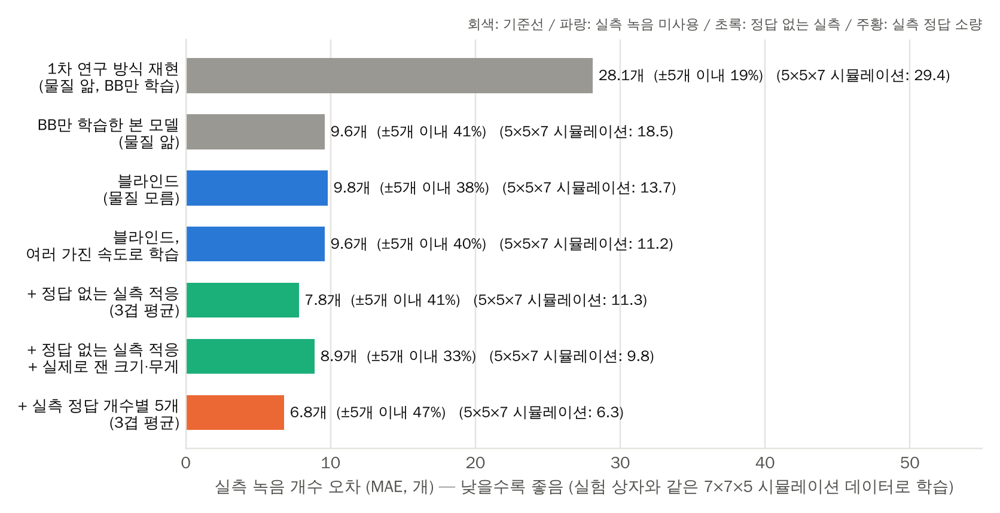
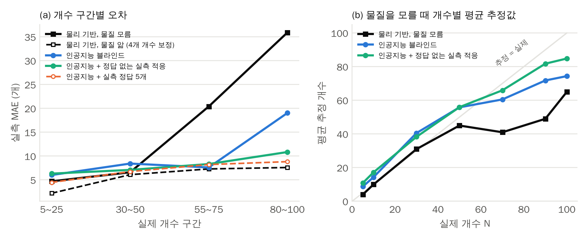
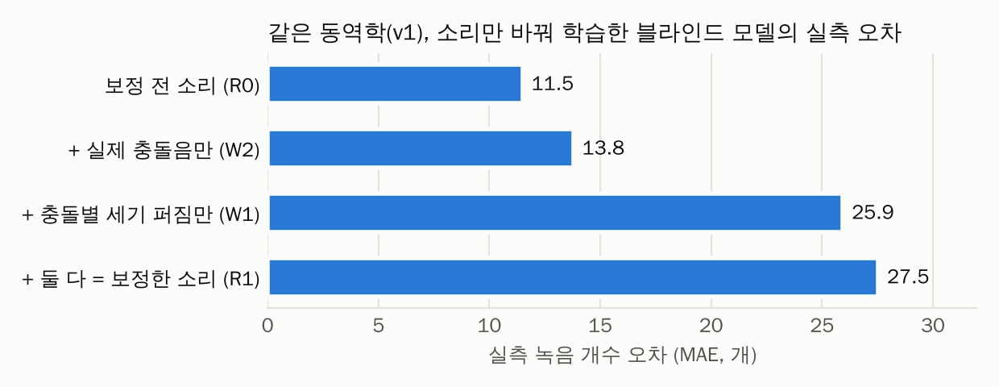
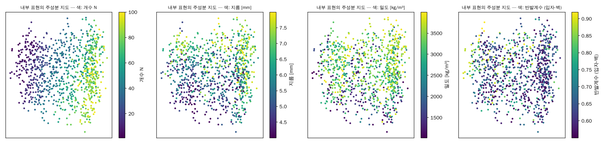

# 연구보고서 인공지능 파트 (물리 파트에 이어 붙일 내용)

*※ 물리 파트가 채워진 보고서의 장 번호에 맞춰 쓴 인공지능 파트이다. 각 절을 보고서의 같은 위치에 옮겨 붙이면 된다: Ⅱ-4는 Ⅱ-3 뒤, Ⅲ-5는 Ⅲ-4 뒤, Ⅳ-3은 Ⅳ-2(표 9) 뒤, Ⅴ-3은 Ⅴ-2 뒤, Ⅵ은 결론 칸. 맨 앞의 서론 문장은 넣고 싶으면 서론 둘째 문단 끝에 붙인다(선택).*

*※ 표와 그림은 모두 Ⅳ-3에 있어 본 문서에 붙이면 번호가 물리 파트 뒤로 자동으로 이어진다(표 10~16, 그림 2~5). 이 파일만 열면 1번부터 보인다. 본문의 표·그림 번호는 이어진 번호로 적었다.*

*※ 실측 녹음은 물리 파트와 같은 1차 연구 BB 녹음이다. 물리 파트는 N = 5~100의 300개를 모두 평가에 썼고, 인공지능 파트는 개수마다 1~5번 녹음을 적응·학습용으로 남기고 6~15번(N = 0~100, 210개)으로 평가하였다. 물리 파트와 비교하는 표 11·12와 그림 3은 N = 5~100으로 맞춰 다시 계산한 값이다.*

### Ⅰ. 서론 — 덧붙일 연결 문장 (선택)

물리 기반 기법은 충돌 통계의 이론으로 관측량과 함수 형태를 정하므로 해석이 분명하고 적은 보정 녹음으로 동작하지만, 물질을 모르면 물질에 따라 달라지는 개수 의존성을 하나의 모형에 담기 어렵다. 인공지능 기법은 물성을 무작위로 바꾼 시뮬레이션 소리로 개수와 물성의 관계를 함께 학습해 이 한계를 보완한다. 본 연구는 두 기법을 같은 실측 녹음으로 비교하고, 한 기법의 결과로 다른 기법을 해석하고 개선한다.

### Ⅱ. 이론적 배경

#### 4. 인공지능 관련 이론

인공지능 파트의 결과(Ⅳ-3)를 해석하는 데 필요한 개념을 정리한다. 소리를 영상으로 바꾸는 방법과 그 영상을 읽는 신경망을 먼저 설명하고, 시뮬레이션으로 학습한 모델을 실제 녹음에 쓸 때의 문제와 해결 방법, 결과를 해석하는 도구를 차례로 다룬다.

#### 4.1. 소리의 시간-주파수 표현: 스펙트로그램과 멜 척도

녹음된 소리는 시간에 따른 압력 신호 x[n]이다. 짧은 시간 창마다 주파수 성분의 세기를 구하면, 가로축이 시간이고 세로축이 주파수인 영상(스펙트로그램)을 얻는다. 이를 단시간 푸리에 변환이라 한다.

$$X(m,k) = \sum_{n} x[n]\, w[n-mH]\, e^{-i 2\pi k n / L}$$

여기서 w는 길이 L의 창 함수, H는 창을 옮기는 간격, m은 시간 창 번호, k는 주파수 번호이고, |X|²가 각 시간·주파수에서의 소리 에너지이다. 충돌 하나는 스펙트로그램에서 넓은 주파수에 걸친 짧은 세로 줄로 나타나므로, 충돌의 빈도와 세기, 겹침(Ⅱ-2)이 영상의 무늬로 드러난다.

멜 척도는 주파수 축을 사람의 음높이 감각에 맞춰, 낮은 주파수는 촘촘히, 높은 주파수는 성기게 묶은 것이다(Stevens 등, 1937). 흔히 m = 2595 log₁₀(1 + f/700)을 쓰며, 묶은 에너지에 로그를 취한 것을 로그-멜 스펙트로그램이라 한다. 로그를 취하면 녹음 게인처럼 곱해지는 효과가 더하기로 바뀌어 다루기 쉽다. 또 표본화 주파수의 절반(나이퀴스트 주파수)보다 높은 성분은 기록되지 않는다. 1차 연구처럼 22.05 kHz로 표본화하면 11 kHz 위가 사라지는데, 충돌음 에너지는 대부분 8~24 kHz에 있으므로 본 연구는 48 kHz 녹음을 그대로 썼다.

#### 4.2. 합성곱 신경망(CNN)

합성곱 신경망은 작은 필터(가중치 묶음)를 영상 위로 옮겨 가며 곱해 더하는 합성곱으로 국소적인 무늬를 찾는다(LeCun 등, 1998).

$$y_{i,j} = f\left(\sum_{u,v} w_{u,v}\, x_{i+u,\,j+v} + b\right)$$

여기서 x는 입력 영상, w는 필터, b는 치우침, f는 음수를 0으로 바꾸는 활성화 함수이다. 같은 필터를 영상 전체에 쓰므로, 충돌음 무늬가 어느 시간에 나타나도 같은 방식으로 찾아낸다. 합성곱 층을 여러 번 쌓으면 앞쪽 층은 짧은 충돌 같은 단순한 무늬를, 뒤쪽 층은 충돌이 얼마나 자주·규칙적으로 일어나는지 같은 넓은 무늬를 잡는다. 마지막에는 영상 전체를 숫자 묶음(내부 표현)으로 요약해 개수를 출력한다. 학습은 예측과 정답의 차이(손실)가 줄어드는 방향으로 필터 값을 조금씩 고치는 경사 하강법으로 한다. 출력 방식은 개수를 연속값으로 바로 내는 회귀와, 개수 구간마다 확률을 내는 분류(1차 연구)가 있다. 본 연구는 불확도를 함께 낼 수 있는 회귀를 썼다(4.6).

#### 4.3. 시뮬레이션으로 학습한 모델과 시뮬레이션-실측 간극

신경망은 정답을 맞히는 데 도움이 되는 단서라면 무엇이든 쓴다. 시뮬레이션을 쓰면 정답(개수와 물성)이 정확히 달린 데이터를 원하는 만큼 만들 수 있지만, 시뮬레이션 소리와 실제 녹음은 완전히 같지 않다. 이 차이를 시뮬레이션-실측 간극이라 한다. 모델이 시뮬레이션에서만 성립하는 단서(예: 합성음 특유의 세기 변화)로 개수를 세었다면, 시뮬레이션에서는 잘 맞아도 실제 녹음에서는 크게 틀린다. 이론적으로 실측 오차는 시뮬레이션 오차와 두 소리 분포 사이의 차이를 더한 값을 넘지 않는다(Ben-David 등, 2010).

$$\varepsilon_{\text{실측}} \leq \varepsilon_{\text{시뮬}} + d(\text{시뮬},\ \text{실측}) + \lambda$$

여기서 ε은 각 영역에서의 개수 오차, d는 모델이 쓰는 단서로 따진 두 소리 분포의 차이, λ는 두 영역 모두에서 잘 맞는 이상적인 모델도 피할 수 없는 오차이다. 따라서 실측 성능을 높이는 길은 두 가지이다. 시뮬레이션 소리를 실제에 가깝게 만들어 d를 줄이거나, 모델이 두 영역에서 똑같이 보이는 단서만 쓰게 하는 것이다. d는 녹음을 길게 해도 줄지 않으므로, 이 항이 크면 오차가 무작위 요동이 아니라 계통 오차로 나타난다(Ⅳ-3.2).

#### 4.4. 간극을 줄이는 방법: 도메인 무작위화와 도메인 적응

도메인 무작위화는 정확히 알 수 없는 조건(입자의 물성, 마이크 게인, 잔향, 잡음 크기 등)을 학습 데이터에서 넓게 바꾸는 방법이다(Tobin 등, 2017). 실제 환경이 학습 데이터의 다양성 안에 들어오면 모델은 실측 녹음을 '또 하나의 변형'으로 처리하며, 물질을 모르는 모델이 가능한 것도 이 덕분이다. 다만 무작위화가 현실에 없는 소리를 만들면 모델이 그 변화를 단서로 배워 실측 성능이 떨어진다(Ⅳ-3.3).

도메인 적대 학습(DANN)은 개수를 모르는 실측 녹음을 학습에 함께 쓰는 방법이다(Ganin 등, 2016). 모델에 '이 소리가 시뮬레이션인가 실측인가'를 맞히는 판별기를 붙이고, 특징 추출 부분은 판별기가 이를 가려내지 못하도록 학습해 두 영역 모두에서 통하는 단서로 개수를 세게 한다. 측정 대상을 흔든 녹음만 있으면 되므로 정답을 모르는 실제 상황에도 쓸 수 있다. 비교를 위해 개수를 아는 실측 녹음을 개수별로 몇 개만 섞어 학습하는 경우도 다루는데, 이는 물리 기반 방법에서 개수를 아는 녹음으로 계수를 보정하는 것(Ⅲ-3)에 대응한다.

#### 4.5. 물질과 개수의 혼동

충돌음은 개수뿐 아니라 입자의 크기, 질량, 반발계수에 따라 함께 변한다. 특히 층 수 F ≈ Nd²/A가 같으면 거동이 비슷하므로(Ⅱ-1), 물질을 모르면 '작은 입자 여러 개'와 '큰 입자 몇 개'가 비슷하게 들린다. 이 혼동은 모델을 아무리 잘 만들어도 완전히 없앨 수 없는 원리적인 한계이다. 크라메르-라오 하한은 자료에 담긴 정보로부터 어떤 추정 방법으로도 넘을 수 없는 오차의 최솟값을 알려 주는데(Kay, 1993), 물성을 함께 추정해야 하면 개수에 대한 정보 일부가 물성과 겹쳐 이 최솟값이 커진다. 반대로 지름이나 무게처럼 잴 수 있는 물성을 알려 주거나, 같은 용기를 여러 가진 속도로 흔든 녹음을 묶어 함께 판단하면(집합 모델, Zaheer 등, 2017) 개수와 물성의 효과가 조건마다 다르게 변해 혼동이 줄어든다.

#### 4.6. 불확도와 예측 구간

물질을 모르면 같은 소리에 여러 개수가 대응할 수 있으므로, 추정값 하나만 내는 것보다 얼마나 확신하는지를 함께 내는 것이 측정 도구로서 더 정직하다. 본 연구의 모델은 개수의 추정값 N̂과 함께 불확도 σ̂(표준편차)을 출력하도록 학습하여(Nix와 Weigend, 1994), 헷갈리는 입력에서는 불확도를 크게 낸다. 학습 뒤에는 검증 데이터로 불확도의 크기를 맞춰, 정답이 90% 확률로 들어가는 예측 구간을 만든다(컨포멀 예측, Angelopoulos와 Bates, 2021).

$$\hat{N} - q\,\hat{\sigma} \leq N \leq \hat{N} + q\,\hat{\sigma}$$

q는 검증 데이터에서 정답의 90%가 구간 안에 들도록 정한 배수이다. 실측에서 이 구간이 정답을 90% 가까이 포함하면 불확도를 믿을 수 있고, 포함률이 크게 낮으면 모델이 실제보다 과신한다는 뜻이다.

#### 4.7. 모델이 배운 것을 들여다보는 방법: 선형 탐침

신경망은 입력을 여러 층에 걸쳐 변환해 마지막에 숫자 묶음(내부 표현)으로 요약한 뒤 답을 낸다. 선형 탐침은 이 내부 표현에서 어떤 물리량을 선형 회귀만으로 얼마나 정확히 복원할 수 있는지를 결정계수 R²로 재는 방법이다(Alain과 Bengio, 2016).

$$R^2 = 1 - \frac{\sum_i (y_i - \hat{y}_i)^2}{\sum_i (y_i - \bar{y})^2}$$

여기서 y는 실제 물리량, ŷ은 내부 표현에서 선형 회귀로 복원한 값, ȳ은 y의 평균이다. R²가 1에 가까우면 모델이 그 물리량을 내부에 분명하게 담고 있다는 뜻이다. 모델에게 가르친 적 없는 물리량이 높게 복원되면, 모델이 문제를 풀기 위해 그 개념을 스스로 만들어 냈다고 해석할 수 있다(Ⅳ-3.6).

### Ⅲ. 연구 방법 및 절차

#### 5. 인공지능을 이용한 추정 방법론

Ⅲ-3, Ⅲ-4의 물리 기반 방법은 관측량과 함수 형태를 이론으로 정하므로 해석이 분명하고, 물질을 알면 몇 개 개수의 보정 녹음만으로 충분하다. 그러나 물질을 모르면 구조적인 한계가 있다. 관측량의 개수 의존성을 정하는 교차점은 물질, 특히 벽 반발계수에 따라 달라지는데(Ⅴ-2), 모든 물질을 하나의 교차 거듭제곱 모형으로 피팅하면 이 차이가 잔차 공분산 Σ에 흩어짐으로 남는다. 물성까지 함께 추정하려면 물성 7가지와 녹음 경로가 관측량을 어떻게 바꾸는지를 모두 이론식으로 적어야 하는데, 이는 현실적으로 어렵다.

인공지능은 이 관계를 이론식 대신 데이터에서 배운다. 같은 시뮬레이터로 물질을 무작위로 바꾼 소리를 많이 만들고, 정해진 관측량 몇 개 대신 소리 전체에서 개수와 물성을 함께 맞히도록 학습한다. 그러면 물질의 차이를 흩어짐으로 남기지 않고 함께 추정할 대상으로 다룰 수 있다. 또 1차 연구의 인공지능은 같은 BB 녹음으로 학습하고 평가했기 때문에 물질이 바뀌는 상황을 다루지 못했고, 새 물질마다 정답 녹음이 수백 개 필요했다. 본 연구는 학습을 시뮬레이션으로 옮겨 이 문제를 피하였다. 그리고 물리 기반 방법과 같은 두 상황(물질을 알 때와 모를 때)을 같은 실측 녹음으로 평가해 두 방법을 비교하였다.

#### 5.1. 학습 데이터

Ⅲ-2의 시뮬레이터(실험과 같은 7×7×5 cm 상자)로 학습용 데이터를 따로 만들었다. 실행마다 개수 N(0~100)과 물성 7가지(지름 4~8 mm, 밀도 1000~4000 kg/m³, 반발계수 입자-입자 0.55~0.97·입자-벽 0.55~0.92, 마찰계수 0.1~0.5, 탄성률 1.5~5 GPa)를 라틴 하이퍼큐브 샘플링으로 뽑았다. 같은 운동 결과에서 녹음 조건(마이크 게인 0.65~1.3배, 직접음과 잔향의 비, 소음 크기, 합성 충돌음 또는 실측 녹음에서 떼어 낸 충돌음)만 바꿔 소리를 4번 합성하였다. 이렇게 물성을 넓게 무작위로 바꾸는 것은 도메인 무작위화(Ⅱ-4.4)로, 모델이 특정 물질의 시뮬레이션에만 있는 세부에 기대지 못하게 한다.

주 데이터는 실행 1,200회(클립 4,800개)이다. 이 밖에 BB의 크기와 무게를 고정한 데이터(물질을 아는 경우, 1,200개), 같은 계를 300~650 rpm의 다섯 속도로 흔든 데이터(5,400개), 벽 반발계수 0.30~0.55의 보충 데이터(1,200개)를 만들었다. 모두 합쳐 동역학 3,600회, 클립 12,600개이다. 시뮬레이션 데이터는 실행 단위로 학습 80%, 검증 10%, 평가 10%로 나누었다. 밀도가 크고 벽 반발계수가 낮은 영역은 학습에서 통째로 빼 '처음 보는 물질' 시험에 썼다.

물리 파트의 시뮬레이션(표 2)과 시뮬레이터는 같지만, 녹음 조건을 다루는 방식이 다르다. 물리 기반 블라인드 방법은 실측에 피팅한 값을 전혀 쓰지 않고 방 부피, 마이크 거리, 탄성률(1.5~70 GPa)까지 넓게 무작위화하였다. 인공지능 데이터는 마이크 응답, 등화기, 기준 게인을 1차 연구 녹음에 맞춘 값으로 두고, 그 주변(게인 ±3 dB 등)에서만 무작위화하였다. 즉 인공지능 파트의 '물질을 모름'은 물질은 모르지만 녹음 장치는 아는 상황이다. 이 차이는 Ⅳ-3.2의 비교에서 함께 고려하였다.

#### 5.2. 모델과 학습

입력은 48 kHz 녹음의 로그-멜 스펙트로그램(Ⅱ-4.1)과 소리 특징 220개(음량, 첨도, 가진 주기에 맞춘 세기 변화 등)이다. 1차 연구의 'CNN과 특징 결합' 구조(Ⅱ-4.2)를 이어받아, 개수와 물성 8가지를 각각 추정값과 불확도로 출력하게 하였다. 물성은 입력으로 주지 않고 함께 맞히게만 했다. 학습 중에는 음량을 ±3 dB 무작위로 바꿔, 모델이 절대 음량 하나에 기대지 않게 하였다. 여러 가진 속도 데이터로는 같은 계를 여러 속도로 녹음한 소리를 한 묶음으로 넣어 함께 판단하는 집합 모델을 학습하였다. 녹음이 하나뿐인 실측은 '녹음 1개짜리 묶음'으로 넣었다.

실측 녹음은 쓰는 정도에 따라 세 가지로 나누었다. ① 블라인드: 시뮬레이션만으로 학습하고 실측 녹음은 평가에만 쓴다. ② 정답 없는 실측 적응: 개수를 모르는 실측 녹음을 함께 넣어 도메인 적대 학습을 한다(Ⅱ-4.4). ③ 소량의 실측 정답: 개수별로 정답이 붙은 실측 녹음 5개씩을 시뮬레이션 데이터에 섞어 학습한다. 물질을 아는 경우는 BB의 크기와 무게를 고정한 데이터로만 학습한 모델로 다루었고, 1차 연구 방식(22 kHz 멜 영상, 21단계 분류)도 같은 데이터로 재현해 기준선으로 삼았다.

#### 5.3. 평가

평가 지표는 물리 파트와 같은 평균 절대오차(MAE)와 편향(추정값 − 실제 개수의 평균)이다. 이와 함께 오차 5개·10개 이내 비율과 90% 예측 구간의 실제 포함률을 보았다. 실측 녹음은 개수마다 1~5번을 적응·학습용으로, 6~15번 210개를 평가용으로 나누었다. 적응에 쓰는 묶음을 1~5번, 6~10번, 11~15번으로 바꿔 세 번 학습하고(3겹 교차검증) 평균을 냈다. 물리 파트와 비교할 때는 같은 개수 범위(N = 5~100)로 다시 계산하였다.

방법은 개발 단계에서 실험 92개로 다듬었다(입력 표현, 모델 구조, 개수 출력 방식, 물성 정보, 실측 녹음 사용법 비교). 실제 실험(녹음)은 처음부터 바닥 7×7 cm, 높이 5 cm 상자로 했지만, 개발 단계의 시뮬레이터에는 상자 치수가 5×5×7 cm로 잘못 들어가 있었다. 시뮬레이터의 치수를 실험 상자와 같게 고친 뒤 데이터를 다시 만들어 핵심 실험 17개를 다시 학습하였다. 바뀐 것은 시뮬레이션 속 상자뿐이고 실측 녹음은 그대로이다. 이하 '5×5×7', '7×7×5'는 학습 데이터를 만든 시뮬레이션의 상자 치수를 뜻하며, 실측 성능은 모두 7×7×5 시뮬레이션으로 다시 학습한 결과이다. 같은 시뮬레이션 안에서 조건만 바꿔 비교한 개발 단계 결과(원인 진단, 내부 표현 해석)는 비교의 결론이 시뮬레이션 상자 치수와 무관하므로 그대로 쓰고 '개발 단계'로 표시하였다.

### Ⅳ. 연구 결과

#### 3. 인공지능을 이용한 추정

Ⅳ-2에서 물리 기반 방법은 물질을 모를 때 실측 MAE 16.9였고, 55개 이상에서 오차가 20~36으로 커졌다(표 8). 이 절에서는 인공지능이 이 한계를 넘는지, 그리고 물질을 알 때는 어떤지를 같은 실측 녹음으로 확인하였다.

#### 3.1. 실측 개수 추정 성능

표 10과 그림 2는 실측 녹음 210개(N = 0~100)에 대한 개수 추정 성능이다. 시뮬레이션 MAE는 여러 물질이 섞인 시뮬레이션 평가 데이터에 대한 값이므로, BB만 학습한 두 모델에게는 학습하지 않은 물질이 대부분이다. 오른쪽 열은 개발 단계에서 치수가 잘못된 시뮬레이션 상자(5×5×7)로 만든 데이터로 학습했을 때, 같은 실측 녹음에 대한 MAE이다.

| 상황 | 모델 | 시뮬레이션 MAE | 처음 보는 물질 MAE | 실측 MAE | 실측 오차 5개 이내 | 실측 편향 | 5×5×7 시뮬레이션으로 학습 시 실측 MAE |
|---|---|---|---|---|---|---|---|
| 물질 앎 | 1차 연구 방식 재현 | 13.2 | 15.5 | 28.1 | 19% | −17.2 | 29.4 |
| 물질 앎 | BB만 학습한 본 모델 | 10.1 | 10.3 | 9.6 | 41% | −4.0 | 18.5 |
| 물질 모름 | 블라인드 | 5.8 | 6.6 | 9.8 | 38% | −1.8 | 13.7 |
| 물질 모름 | 블라인드, 여러 가진 속도로 학습 | 6.6 | 9.2 | 9.6 | 40% | +0.8 | 11.2 |
| 물질 모름 | + 정답 없는 실측 적응 (3겹 평균) | 7.4 | 8.4 | 7.8 | 41% | +1.1 | 11.3 |
| 크기·무게 앎 | + 정답 없는 실측 적응 + 실제로 잰 크기·무게 (3겹 평균) | 5.8 | 7.0 | 8.9 | 33% | +2.6 | 9.8 |
| 물질 모름 | + 실측 정답 개수별 5개 (3겹 평균) | 6.3 | 6.9 | 6.8 | 47% | +1.6 | 6.3 |

**표 10. 인공지능 모델의 실측 개수 추정 성능 (실측 210개)**

{width=95%}

물질을 아는 두 모델은 같은 BB 시뮬레이션 데이터로 학습했지만 결과가 크게 달랐다. 1차 연구 방식은 실측 MAE 28.1, 본 모델은 9.6으로 오차가 66% 작았다. 1차 연구 방식은 80~100개를 평균 56개나 적게 세었는데(표 12), 두 모델은 데이터가 같고 모델 설계(입력 표현, 소리 특징, 개수 출력 방식, 학습 방법)만 다르므로, 같은 데이터에서도 설계에 따라 실측 오차가 3배 달랐다.

물질을 모르는 블라인드 모델의 실측 MAE는 9.8로, 물질을 아는 모델(9.6)과 거의 같았다. 물질을 무작위로 바꿔 학습해도 실제 BB에서 성능을 거의 잃지 않은 것이다. 시뮬레이션(5.8), 처음 보는 물질(6.6), 실측(9.8) 사이의 차이도 작아, 실제 BB를 학습한 여러 물질 중 하나처럼 다루었다. 정답 없는 실측 녹음으로 적응하면 7.8, 개수별 정답 5개를 더하면 6.8까지 줄었다. 실제로 잰 크기와 무게를 더 알려 줘도 좋아지지 않았는데(8.9), 블라인드 모델이 이미 물질을 아는 모델과 같은 수준이어서 덜어 줄 물질 혼동이 작았기 때문으로 보인다.

시뮬레이션의 상자 치수를 실험 상자와 같게 고치자 실측 오차가 블라인드는 13.7에서 9.8로, 정답 없는 적응은 11.3에서 7.8로, BB만 학습한 모델은 18.5에서 9.6으로 줄었다. 시뮬레이션 MAE는 비슷했으므로(블라인드 6.8→5.8), 줄어든 오차는 시뮬레이션과 실제의 차이가 줄어든 데서 왔다. 바닥 넓이가 2배가 되면 같은 N에서 층 수가 절반이 되어 충돌 양상이 달라진다(Ⅱ-1). 반면 실측 정답 5개를 쓴 모델은 6.3에서 6.8로 거의 그대로였는데, 실측 정답이 시뮬레이션의 차이를 이미 메워 주었기 때문으로 보인다.

#### 3.2. 물리 기반 방법과의 비교

물리 파트와 같은 개수 범위(N = 5~100)로 맞춰 두 방법을 비교하였다(표 11, 표 12, 그림 3). 물리 파트의 25초 측정(5초 클립 5개의 관측량 평균)에 대응해, 인공지능은 같은 개수의 녹음 5개에서 나온 추정을 평균한 값도 계산하였다.

| 쓴 정보 | 물리 기반, 5초 | 인공지능, 5초 | 물리 기반, 25초 | 인공지능, 5개 평균 |
|---|---|---|---|---|
| 개수를 아는 실측 녹음으로 보정 | 6.1 (82%) 물질 앎, 4개 개수 × 15회 | 7.0 (75%) 21개 개수 × 5회 정답, 3겹 평균 | 3.3 (100%) | 5.4 (87%) |
| 물질 앎, 보정 녹음 없음 | – | 9.9 (61%) BB 시뮬레이션만 학습 | – | 9.1 (62%) |
| 물질 모름, 보정 녹음 없음 | 16.9 (–) | 10.3 (57%) 블라인드 | – | 9.4 (65%) |
| 물질 모름, 정답 없는 실측 녹음 | – | 8.1 (70%) 3겹 평균 | – | 7.3 (79%) |

**표 11. 물리 기반 방법과 인공지능의 실측 비교 (N = 5~100, MAE와 괄호 안 ±10개 이내 비율)**

| 방법 | N 5~25 | N 30~50 | N 55~75 | N 80~100 |
|---|---|---|---|---|
| 물리 기반, 물질 앎, 4개 개수 보정 (표 6) | 2.2 | 6.1 | 7.3 | 7.6 |
| 물리 기반, 물질 모름 (표 8) | 4.7 | 6.6 | 20.4 | 35.9 |
| 1차 연구 방식 재현 | 20.7 | 9.6 | 32.1 | 55.6 |
| 인공지능 블라인드 | 6.0 | 8.4 | 7.6 | 19.0 |
| 인공지능 블라인드, 여러 가진 속도 | 3.6 | 12.4 | 10.8 | 12.9 |
| 인공지능 + 정답 없는 실측 적응 (3겹 평균) | 6.3 | 7.1 | 8.3 | 10.8 |
| 인공지능 + 실측 정답 개수별 5개 (3겹 평균) | 4.5 | 6.7 | 8.2 | 8.8 |

**표 12. 개수 구간별 실측 MAE: 물리 기반 방법과 인공지능 (N = 5~100)**

{width=95%}

물질을 모를 때는 인공지능이 전체적으로 더 정확하였다(10.3 대 16.9). 그러나 차이는 큰 개수에서만 났다. 5~50개에서는 물리 기반 방법이 블라인드 모델보다 오히려 조금 더 정확했고(4.7·6.6 대 6.0·8.4), 55개 이상에서 인공지능이 크게 앞섰다(7.6·19.0 대 20.4·35.9). 그림 3(b)에서 물리 기반 방법의 평균 추정은 실제 50~90개에서 41~49에 머물렀지만(표 9), 인공지능의 평균 추정은 실제 100개에서 블라인드 74, 정답 없는 적응 85까지 계속 커졌다. 대신 인공지능은 적은 개수를 많게 세는 경향이 있었다(5~25개 편향 블라인드 +6.0, 정답 없는 적응 +6.2).

개수를 아는 녹음으로 보정할 수 있으면 물리 기반 방법이 더 정확하였다(6.1 대 7.0). 물리 기반 방법은 4개 개수의 녹음만 썼는데도 모든 구간에서 인공지능(21개 개수 모두에 정답을 준 모델)보다 오차가 작았다. 관측량과 함수 형태가 이론으로 정해져 있어, 몇 개 개수에서 맞춘 계수로 그 사이를 정확히 메울 수 있기 때문이다.

두 방법은 오차의 성격도 달랐다. 녹음 5개를 평균하면 물리 기반 방법은 오차가 절반이 되었지만(6.1→3.3), 인공지능 블라인드 모델은 10.3에서 9.4로 거의 줄지 않았다. 물리 기반 방법의 오차는 주로 5초 녹음 안의 충돌 수 요동에서 오고, 인공지능의 오차는 시뮬레이션과 실제의 차이에서 오는 계통 오차가 대부분이라는 뜻이다. 실측 정답으로 그 차이를 줄인 모델은 평균하면 7.0에서 5.4로, 정답 없는 적응 모델은 8.1에서 7.3으로 줄었다.

오차를 녹음마다 달라지는 무작위 오차 s와 녹음을 늘려도 남는 계통 오차 b로 나누면, 녹음 n개를 평균한 오차 e_n은 대략 다음과 같다.

$$e_n^2 \approx b^2 + \frac{s^2}{n}$$

n = 1, 5의 값을 넣어 어림하면(MAE를 그대로 넣은 대략적인 값) 무작위 오차 s는 물리 기반(물질 앎) 5.7, 인공지능 4~5로 비슷하였다. 반면 계통 오차 b는 물리 기반이 2.1인데, 인공지능은 블라인드 9.2, 정답 없는 적응 7.1, 실측 정답 5개 4.9였다. 실측 녹음을 더 쓸수록 인공지능의 계통 오차가 줄어드는 것이 수치로 드러난다.

다만 두 방법이 쓴 정보가 같지는 않다. 물리 기반 블라인드 방법은 실측에 피팅한 값을 전혀 쓰지 않았고 녹음 경로를 넓게 무작위화했으며, 녹음 게인을 모른다고 보고 소리 세기를 쓰지 않았다. 인공지능은 녹음 장치 특성을 1차 연구 녹음에 맞추고 게인을 ±3 dB 안에서만 바꿨으므로, 음량도 일부 단서로 쓸 수 있었다. 학습 데이터도 더 많았다(주 데이터 4,800개 대 1,426개). 따라서 물질을 모를 때의 차이(10.3 대 16.9)에는 녹음 장치 정보를 더 쓴 몫이 섞여 있다. 같은 시뮬레이터 안의 성능(물리 17.9, 인공지능 5.8)도 무작위화 범위가 달라 직접 비교할 수 없다. 큰 개수에서 물리 기반 방법의 추정이 멈추는 현상(그림 3(b))의 원인은 Ⅴ-3.1에서 논의한다.

#### 3.3. 개발 단계: 실측 오차의 원인 진단

개발 단계에서 1차 연구 녹음에 맞춰 소리를 정교하게 보정했더니, 실측 MAE가 보정 전(11.5)보다 오히려 커졌다(25.4). 원인 후보는 동역학 보정, 실제 충돌음 삽입, 충돌별 세기 무작위화 세 가지였다. 이를 가르기 위해 같은 운동 결과에 소리만 바꿔 다시 합성하고 같은 모델을 학습하였다(표 13, 그림 4).

| 학습한 소리 | 시뮬레이션 MAE | 실측 MAE | 실측 편향 | N 5~25 편향 | N 30~50 편향 |
|---|---|---|---|---|---|
| 보정 전 소리 | 7.5 | 11.5 | +0.4 | +8.4 | +13.2 |
| + 실제 충돌음만 | 6.2 | 13.8 | +7.3 | +15.4 | +20.6 |
| + 충돌별 세기 무작위화만 | 7.8 | 25.9 | +21.7 | +47.9 | +37.2 |
| + 둘 다 (보정한 소리) | 8.2 | 27.5 | +22.7 | +51.0 | +37.4 |

**표 13. 소리만 바꾼 원인 진단 실험 (개발 단계, 블라인드 모델)**

{width=95%}

실측 오차가 커진 원인의 거의 전부는 충돌별 세기 무작위화였다(11.5→25.9). 진폭 분포의 첨도를 실측에 맞추려고 충돌마다 세기를 무작위로 바꿨는데, 이것이 고음 대역에서 소리 세기의 시간 변화를 불규칙하게 만들었다. Ⅱ-2의 초과 첨도 식에서 개수 정보는 겹치는 충돌 수 λτ에 있고, 분자 ⟨a⁴⟩/⟨a²⟩²는 충돌 세기 분포의 모양이다. 충돌마다 세기에 로그정규 퍼짐 σ를 곱하면 이 비가 다음과 같이 커진다.

$$\frac{\langle a^4\rangle}{\langle a^2\rangle^2} \;\rightarrow\; e^{4\sigma^2}\,\frac{\langle a^4\rangle}{\langle a^2\rangle^2}$$

σ를 클립마다 0~1.5에서 뽑았으므로, 희박 영역에서는 같은 개수라도 첨도가 최대 e⁹(약 8000)배까지 달라질 수 있다. 첨도와 변동계수 같은 불규칙성은 개수가 늘수록 작아지는 개수 단서인데(Ⅱ-2), 세기 퍼짐이 이 단서와 개수의 관계를 실제와 다르게 만든 것이다. 그 결과 모델은 실측을 많은 개수로 읽었다(N 5~25 편향 +48). 첨도 하나를 맞추려던 무작위화가 모델이 실제로 쓰는 개수 단서를 틀어 놓은 것이다.

세기 무작위화만 빼고 소리를 다시 합성하자 실측 MAE가 25.4에서 13.7로 줄었고, 시뮬레이션 MAE도 8.9에서 6.8로 줄었다. 세기 무작위화는 실측 전이뿐 아니라 시뮬레이션 안에서도 개수 단서를 흐리는 잡음이었던 것이다. 상자 치수를 고쳐 다시 만든 시뮬레이션 데이터는 처음부터 이 무작위화를 뺐다.

#### 3.4. 실측 녹음 활용, 재현성, 불확도

| 실측 녹음 사용 | 1~5번 사용 | 6~10번 사용 | 11~15번 사용 | 평균 | 오차 5개 이내 |
|---|---|---|---|---|---|
| 쓰지 않음 (블라인드) | 9.8 | – | – | 9.8 | 38% |
| 정답 없이 개수별 5개 | 7.9 | 7.6 | 8.0 | 7.8 | 41% |
| 정답 없이 5개 + 실제로 잰 크기·무게 | 10.3 | 8.0 | 8.4 | 8.9 | 33% |
| 정답 붙여 개수별 5개 | 6.3 | 5.8 | 8.3 | 6.8 | 47% |

**표 14. 실측 녹음을 쓰는 방식에 따른 실측 MAE (3겹 교차검증)**

적응·학습에 쓰는 녹음 묶음을 바꿔 세 번씩 학습하고, 나머지 녹음으로 평가하였다(표 14). 정답 없는 실측 적응은 어느 묶음을 써도 7.6~8.0으로 고르게 나와, 특정 녹음에 기댄 결과가 아니었다. 정답 5개를 붙인 학습은 평균 6.8로 가장 정확했지만 11~15번 묶음은 8.3으로, 어떤 녹음을 정답으로 쓰느냐에 따라 2 정도 달라졌다. 같은 설정에서 시드만 바꾼 반복 학습의 차이는 개발 단계에서 0.2~2.4였으므로, 시뮬레이션 상자 정정에 따른 개선(3.5~3.9)은 우연보다 크다.

여러 가진 속도로 학습한 집합 모델은 적은 개수(5~25개, 3.6)에서 가장 정확했다. 그러나 여기에 정답 없는 실측 적응을 더하자 개발 단계(9.1)와 달리 14.7로 나빠졌고, 30~75개를 16~22개 많게 세었다. 실측은 한 속도의 녹음 하나뿐이어서 여러 속도를 묶은 시뮬레이션 입력과 모양이 다르다. 그래서 판별기가 개수와 관계없는 이 차이까지 지우려 했을 가능성이 있으나, 원인은 확인하지 못하였다.

Ⅱ-4.6의 90% 예측 구간은 실측에서도 믿을 만하였다. 실제 개수를 포함한 비율은 블라인드 모델이 실측 89%(시뮬레이션 97%), 정답 없는 적응이 74~87%였다. 1차 연구 방식은 41%로, 틀리면서도 확신하였다. 또 실측 녹음의 가진 진동수는 6.04~6.64 Hz로 흔들렸지만, 본 모델의 추정은 1 Hz당 1~5개만 바뀌어 이 흔들림에 둔감하였다(1차 연구 방식은 8개).

#### 3.5. 물성 추정과 개수-지름 혼동

블라인드 모델은 개수와 함께 물성도 추정한다(표 15). 시뮬레이션에서 지름은 R² 0.68(평균 오차 0.5 mm), 질량은 0.83으로 추정되었지만, 밀도는 0.34로 약했다. 밀도는 지름과 질량에서 간접적으로 정해지므로 두 오차가 겹치기 때문이다.

| 물성 | 시뮬레이션 R² | 실제 BB 값 | 블라인드 추정 | 정답 없는 적응 추정 |
|---|---|---|---|---|
| 지름 | 0.68 | 6.0 mm | 5.3 mm | 6.3 mm |
| 질량 | 0.83 | 0.12 g | 0.10 g | 0.20 g |
| 밀도 | 0.34 | 1060 kg/m³ | 1280 kg/m³ | 1780 kg/m³ |

**표 15. 블라인드 모델의 물성 추정 (시뮬레이션 R²와 실제 BB 녹음에서의 추정값 중앙값)**

실제 BB 녹음에서 지름은 블라인드 5.3 mm, 정답 없는 적응 6.3 mm로 실제(6.0 mm)와 0.3~0.7 mm 차이였다. 반면 질량과 밀도는 크게 벗어났고, 특히 정답 없는 적응 모델은 질량을 0.20 g으로 실제의 1.7배로 보았다. 질량 추정은 절대 음량에 크게 기대는데, 적응 학습이 개수를 맞추려고 시뮬레이션과 실측의 차이를 지우면서 음량의 해석도 바꾼 것으로 보인다. 실측에서 쓸 만한 물성 추정은 지름 정도이다.

개수와 지름은 서로 헷갈린다. 블라인드 모델의 개수 오차와 지름 오차의 상관은 −0.32로, 지름을 작게 보면 개수를 많게 보았다. 층 수 F ≈ Nd²/A가 같으면 거동이 비슷하므로(Ⅱ-1), 작은 입자 여러 개와 큰 입자 몇 개는 소리도 비슷하기 때문이다. BB만 학습한 모델을 여러 물질의 시뮬레이션에 적용하면 이 상관이 −0.62로 커졌다. 물질을 BB로 가정한 모델은 다른 물질을 만나면 지름 차이를 개수 차이로 읽는 것이다. 물성을 함께 맞히도록 학습하면 이 혼동이 절반으로 줄었다.

#### 3.6. 개발 단계: 모델이 스스로 배운 물리량

정답 없는 실측 적응 모델의 내부 표현(128차원)에서 시뮬레이션의 실제 물리량을 선형 회귀로 얼마나 복원할 수 있는지(R², Ⅱ-4.7)를 보았다(표 16, 그림 5). 모델은 개수와 물성만 맞히도록 학습했고, 운동 상태(상)에 대한 정보는 받지 않았다.

| 분류 | 물리량 (R²) |
|---|---|
| 학습한 목표 | 개수 0.89, 질량 0.82, 지름 0.61, 벽 반발계수 0.51, 입자끼리 반발계수 0.16, 탄성률 0.07, 마찰 ≈ 0 |
| 운동 상태 지표 (학습하지 않음) | 가진 위상 집중도 0.95, 평균 높이 0.94, 자유 비행 비율 0.89, 집단성 0.89, 입자당 충돌 빈도 0.86, 지속 접촉 비율 0.58 |

**표 16. 모델 내부 표현에서 복원한 물리량의 R² (개발 단계, 시험 클립 940개)**

{width=95%}

모델은 충돌이 판의 특정 위상에 몰리는 정도(가진 위상 집중도, R² 0.95)와 층이 함께 움직이는 정도(집단성, 0.89)를 스스로 내부에 만들었다. 이는 Ⅱ-1의 고체 같은 거동과 기체 같은 거동을 가르는 지표이며, 물리 파트가 위상 고정을 관측량으로 쓴 것(표 3)과 같은 정보이다. 개수를 세기 위해 먼저 '층이 한 덩어리로 움직이는가'를 파악하는 방식을, 이론을 받지 않고 데이터에서 배운 셈이다. 반대로 소리에 거의 드러나지 않는 마찰과 탄성률은 복원되지 않아(R² ≈ 0), 드러나지 않는 물성을 억지로 맞히지 않았음도 확인하였다. 또 주파수 대역을 하나씩 가려도 개수 오차는 0.5% 미만으로만 늘어, 모델이 특정 대역 하나가 아니라 넓은 대역의 정보를 함께 쓴다는 것을 보였다.

### Ⅴ. 고찰

#### 3. 인공지능을 이용한 추정

#### 3.1. 물질을 모를 때 두 방법의 차이

물리 기반 방법은 물질에 따라 달라지는 교차점을 하나로 고정하고, 물질의 차이를 공분산 Σ로 옮겼다. 희박 영역에서는 관측량이 샷 노이즈 이론이 정한 지수의 거듭제곱을 따르므로(Ⅱ-2), 적은 개수에서는 이 방식이 잘 맞았다(5~25개 MAE 4.7). 그러나 큰 N에서는 두 가지 원인으로 추정이 40~50 부근에 머물렀다(Ⅴ-2). 교차점이 물질마다 달라 물질 차이가 개수 변화보다 커졌고, 시뮬레이션 관측량이 실측보다 일찍 평평해졌다.

인공지능은 물질과 개수를 함께 맞히도록 학습하므로, 물질마다 다른 개수 의존성을 각각 배워 첫째 원인을 피할 수 있다. 그래서 큰 개수에서도 추정이 멈추지 않고 커졌다(그림 3(b)). 그러나 같은 시뮬레이터로 학습했으므로 둘째 원인은 그대로 물려받아, 과소추정이 줄었을 뿐 남았다(3.3절). 실제로 시뮬레이션 안에서도 블라인드 모델의 개수 오차는 처음 보는 물질에서 6.6으로 학습한 물질 범위(5.8)와 비슷했다. 반면 적은 개수에서는 물리 기반 방법보다 조금 부정확했고, 많게 세는 편향(+6)이 있었다. 인공지능은 이론으로 정해진 기울기 없이 시뮬레이션의 모든 단서를 쓰므로, 시뮬레이션과 실제가 조금만 달라도 그 차이가 그대로 계통 오차가 되기 때문이다. 녹음 5개 평균으로 오차가 거의 줄지 않은 것(Ⅳ-3.2)이 그 증거이다.

두 방법의 장단점이 개수 구간에 따라 갈리므로, 적은 개수는 물리 기반 방법, 많은 개수는 인공지능을 쓰는 결합이 가능하다. 구간별 MAE(표 12)로 보면 물질을 모를 때 5~50개는 물리 기반, 55~100개는 정답 없는 적응 모델을 쓰면 각 구간 오차가 4.7, 6.6, 8.3, 10.8이 된다. 다만 실제로는 어느 구간인지를 먼저 판단해야 하고 두 방법의 평가 녹음도 조금 다르므로, 이는 가장 낙관적인 값이며 후속 연구에서 검증할 과제이다.

#### 3.2. 실측 성능을 좌우한 것은 시뮬레이션의 정확도

인공지능의 실측 오차를 가장 크게 줄인 것은 모델 구조가 아니라 학습 데이터가 실제를 얼마나 닮았는가였다. 개발 단계에서 입력 표현이나 개수 출력 방식을 바꿔도 시뮬레이션 MAE는 8.8~10.1에 머물렀다. 반면 세기 무작위화를 빼자 실측 오차가 거의 절반이 되었고(25.4→13.7), 시뮬레이션의 상자 치수를 바로잡자 다시 9.8로 줄었다. 그다음 개선은 실측 쪽 정보에서 왔다(정답 없는 녹음 7.8, 정답 5개 6.8). 무작위화는 맞추려는 통계 하나가 아니라 모델이 실제로 쓰는 개수 단서 전체를 기준으로 확인해야 하며, 그 단서가 무엇인지는 물리 파트의 샷 노이즈 이론(Ⅱ-2)이 알려 주었다.

#### 3.3. 큰 개수의 과소추정

인공지능도 80~100개에서 과소추정하였다(블라인드 −19.0, 정답 없는 적응 −10.3). 물리 파트가 찾은 원인과 같은 방향이다(Ⅴ-2). 물질을 모르면 큰 N의 정보가 줄어들고, 시뮬레이션은 큰 N에서 실측보다 덜 변한다. 두 방법은 같은 시뮬레이터를 쓰므로, 서로 다른 추정 방식이 같은 방향으로 틀렸다는 것은 오차의 원인이 추정 방식보다 시뮬레이터에 있다는 증거이다. 정답 없는 실측 적응으로 과소추정이 절반으로 줄었으나 없어지지는 않았다. 충돌 시점을 흩뜨리는 기작(가진기의 비정현 운동, 수평 진동)을 시뮬레이터에 넣는 것이 두 방법 모두의 다음 과제이다.

#### 3.4. 두 방법의 연결

두 방법은 서로를 해석하고 개선하는 데 쓰였다. 물리에서 인공지능으로는, 층 수가 거동을 정한다는 이론(Ⅱ-1)이 시뮬레이션 상자 치수 정정이 실측 오차를 크게 줄인 이유와 개수-지름 혼동(Ⅳ-3.5)을 설명했고, 샷 노이즈 이론(Ⅱ-2)이 세기 무작위화가 개수 단서를 틀어 놓은 이유를 설명했다. 또 시뮬레이터 보정에서 실측과 가장 잘 맞는 벽 반발계수가 0.4로 주 데이터 범위(0.55~0.92)보다 낮았으므로, 0.30~0.55의 보충 데이터를 넣었다. 벽 반발계수는 Ⅴ-2에서 보듯 교차점을 크게 바꾸는 물성이다. 다만 상자 치수를 고친 시뮬레이션에서는 효과가 작았다(9.8→9.5).

인공지능에서 물리로는, 개수만 배운 모델이 가진 위상 집중도와 집단성을 스스로 만든 것(Ⅳ-3.6)이 물리 파트가 고른 관측량(위상 고정, 충돌 통계)이 개수 추정의 핵심 정보라는 것을 독립적으로 뒷받침한다. 또 인공지능이 큰 개수까지 추정을 이어 간 것은, 물질을 모를 때도 큰 개수의 정보가 소리에 어느 정도 남아 있으며, 물리 기반 방법의 한계 중 일부는 하나의 교차점으로 모든 물질을 나타낸 모형 구조에서 왔을 가능성을 보여 준다. 다만 인공지능은 녹음 장치 정보를 더 썼으므로, 확정하려면 같은 정보 조건에서 다시 비교해야 한다.

쓰임새로 보면, 물질을 알고 개수를 아는 녹음을 몇 개 만들 수 있을 때는 해석이 분명하고 보정 녹음이 적게 드는 물리 기반 방법이 알맞다. 물질을 모를 때, 특히 개수가 많을 때는 인공지능이 알맞으며, 정답 없는 녹음만 모을 수 있어도 적응으로 정확도를 더 높일 수 있다.

#### 3.5. 한계

첫째, 모델에 물성을 알려 주지는 않았지만, 시뮬레이터의 녹음 장치 설정(마이크 게인, 응답, 등화기, 실제 충돌음)은 1차 연구 녹음으로 맞췄다. 따라서 인공지능 파트의 블라인드는 '물질 정보 없음'이며, 물리 기반 블라인드 방법처럼 녹음 장치까지 모르는 경우의 성능은 이보다 낮을 수 있다. 둘째, 실측 검증은 BB 한 종류, 한 가진 속도뿐이다. 셋째, 원인 진단과 내부 표현 해석은 상자 치수가 잘못된 개발 단계 시뮬레이션에서 얻었으므로, 치수를 고친 시뮬레이션에서 다시 확인하지는 않았다. 넷째, 실측 평가 녹음이 물리 파트(개수별 15개)와 인공지능 파트(개수별 10개)에서 조금 다르다. 다섯째, 여러 가진 속도 모델에 정답 없는 적응을 더한 조합이 실패한 원인은 밝히지 못하였다.

### Ⅵ. 결론 (인공지능 파트)

물리 기반 방법은 물질을 모르면 물질에 따라 달라지는 개수 의존성을 하나의 모형에 담기 어렵다. 인공지능 파트에서는 이 한계를 보완하기 위해, 물성을 무작위로 바꾼 시뮬레이션 소리로 개수와 물성을 함께 맞히는 모델을 학습하고 실제 녹음으로 평가하였다.

첫째, 물질을 모르는 블라인드 모델이 실측 녹음에서 MAE 9.8(오차 5개 이내 38%)을 얻었다. 같은 조건의 1차 연구 방식(28.1)보다 65% 정확하고, 물질을 아는 모델(9.6)과 거의 같았다. 물성을 함께 맞히게 하자 작은 입자 여러 개와 큰 입자 몇 개를 헷갈리는 개수-지름 혼동이 절반으로 줄었고, 실제 BB의 지름을 0.3~0.7 mm 차이로 추정하였다.

둘째, 물질을 모를 때 같은 개수 범위에서 물리 기반 방법(16.9)보다 정확하였다(10.3). 차이는 55개 이상에서 났고, 물리 기반 방법의 추정이 40~50에 머무는 동안 인공지능은 큰 개수까지 추정을 이어 갔다. 반면 적은 개수와 물질을 아는 경우에는 물리 기반 방법이 더 정확하였다(보정 시 6.1 대 7.0). 단, 인공지능은 녹음 장치 특성을 1차 연구 녹음에 맞춘 조건이다.

셋째, 정답 없는 실측 녹음으로 적응하면 7.8, 개수별 정답 녹음 5개를 더하면 6.8까지 오차가 줄었다. 3겹 교차검증으로 결과가 특정 녹음에 기대지 않음을 확인하였고, 실측에서 90% 예측 구간이 실제 개수를 89% 포함해 불확도도 믿을 만하였다.

넷째, 인공지능의 실측 성능은 시뮬레이션이 실제를 얼마나 닮았는지가 좌우하였다. 소리만 바꾼 대조 실험으로 합성음의 결함(충돌별 세기 무작위화)을 찾아 고쳤고(25.4→13.7), 시뮬레이션의 상자 치수를 바로잡자 9.8로 다시 줄었다. 인공지능의 오차는 녹음을 길게 해도 줄지 않는 계통 오차여서, 시뮬레이터의 정확도가 곧 성능의 한계이다.

다섯째, 개수만 배운 모델이 내부에 고체 같은 거동과 기체 같은 거동을 가르는 가진 위상 집중도(R² 0.95)를 스스로 만들어, 인공지능의 판단을 과립계 물리로 해석할 수 있었다.

두 방법은 서로 보완적이다. 물리 기반 방법은 해석이 분명하고 적은 보정으로 정확하며, 인공지능의 실패 원인을 설명하는 데 쓰였다. 인공지능은 물질을 모르는 큰 개수에서 강하고, 물리 기반 방법이 고른 관측량이 핵심 정보임을 독립적으로 확인하였다. 남은 큰 개수의 과소추정은 두 방법에 공통이므로 시뮬레이터에 빠진 충돌 시점의 흩어짐을 넣는 것이 다음 과제이다. 또한 녹음 장치 조건까지 넓게 무작위화한 학습, 개수 구간에 따라 두 방법을 결합하는 추정, 다른 입자와 여러 가진 속도의 실측 검증으로 연구를 확장할 것이다.

### 참고문헌 (인공지능 파트에서 인용한 것, 물리 파트 목록에 이어 번호를 매길 것)

S. S. Stevens, J. Volkmann, and E. B. Newman, "A scale for the measurement of the psychological magnitude pitch," The Journal of the Acoustical Society of America, vol. 8, no. 3, pp. 185–190, 1937.

Y. LeCun, L. Bottou, Y. Bengio, and P. Haffner, "Gradient-based learning applied to document recognition," Proceedings of the IEEE, vol. 86, no. 11, pp. 2278–2324, 1998.

S. Ben-David, J. Blitzer, K. Crammer, A. Kulesza, F. Pereira, and J. W. Vaughan, "A theory of learning from different domains," Machine Learning, vol. 79, pp. 151–175, 2010.

J. Tobin, R. Fong, A. Ray, J. Schneider, W. Zaremba, and P. Abbeel, "Domain randomization for transferring deep neural networks from simulation to the real world," Proc. IEEE/RSJ IROS, pp. 23–30, 2017.

Y. Ganin, E. Ustinova, H. Ajakan, P. Germain, H. Larochelle, F. Laviolette, M. Marchand, and V. Lempitsky, "Domain-adversarial training of neural networks," Journal of Machine Learning Research, vol. 17, no. 59, pp. 1–35, 2016.

S. M. Kay, Fundamentals of Statistical Signal Processing: Estimation Theory. Upper Saddle River, NJ: Prentice Hall, 1993.

M. Zaheer, S. Kottur, S. Ravanbakhsh, B. Poczos, R. Salakhutdinov, and A. Smola, "Deep sets," Advances in Neural Information Processing Systems 30, 2017.

D. A. Nix and A. S. Weigend, "Estimating the mean and variance of the target probability distribution," Proc. IEEE International Conference on Neural Networks, pp. 55–60, 1994.

A. N. Angelopoulos and S. Bates, "A gentle introduction to conformal prediction and distribution-free uncertainty quantification," arXiv:2107.07511, 2021.

G. Alain and Y. Bengio, "Understanding intermediate layers using linear classifier probes," arXiv:1610.01644, 2016.

왕주완, 배성재, 신윤석, 「진동 음향 신호를 이용한 용기 내부의 물체의 개수 분석」, 서울과학고등학교 R&E 연구보고서, 2026. (1차 연구)
