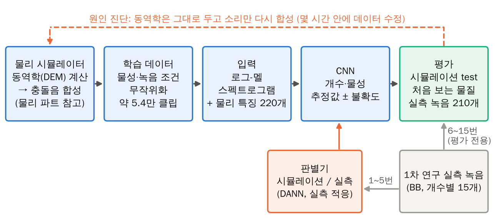
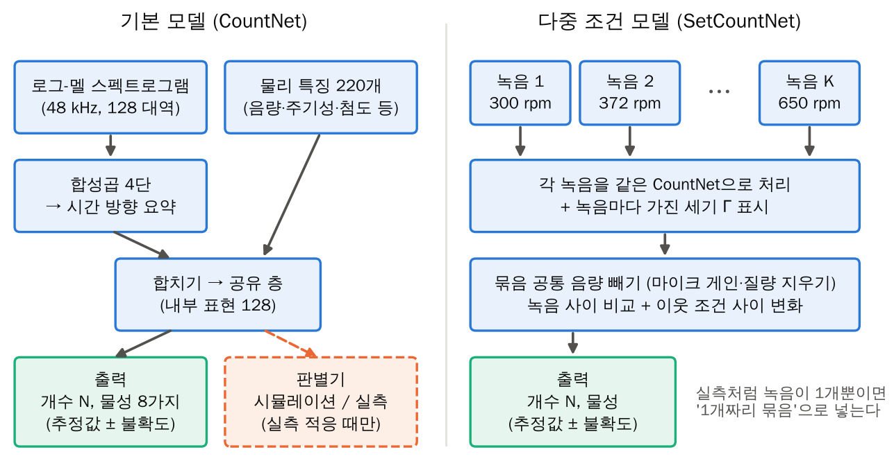
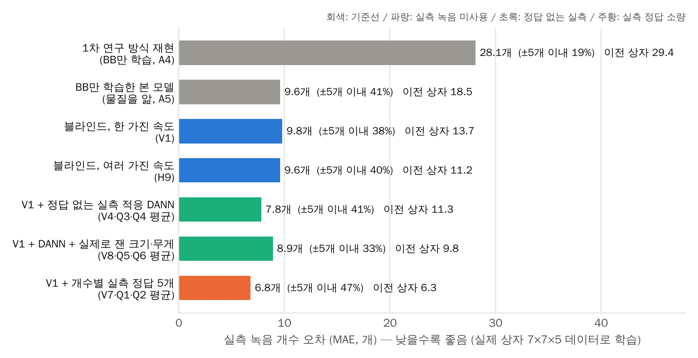
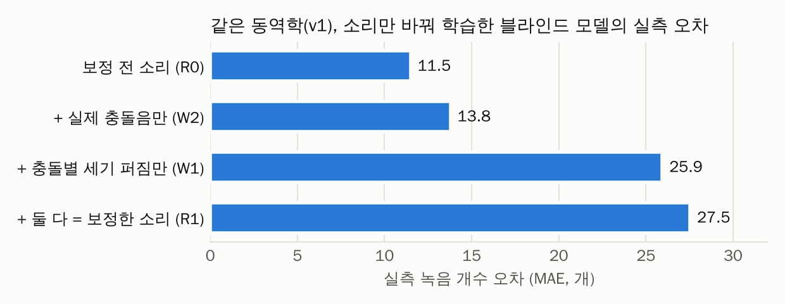
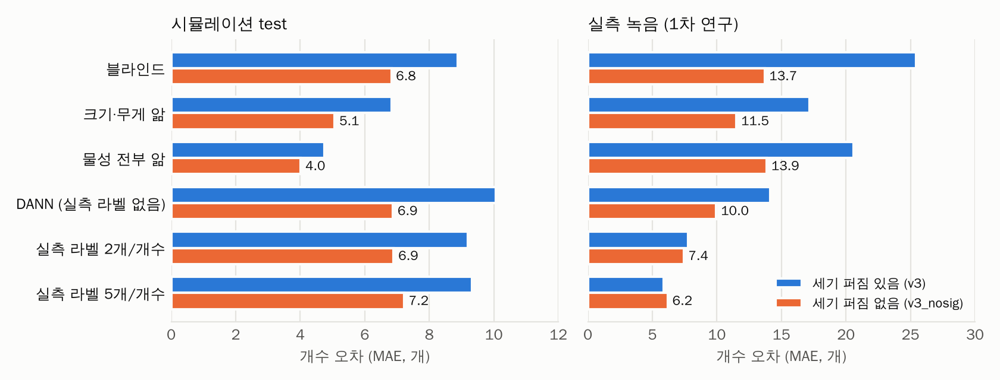
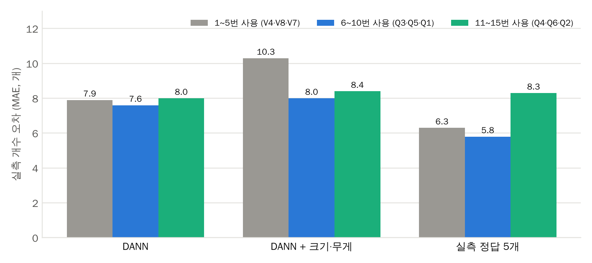
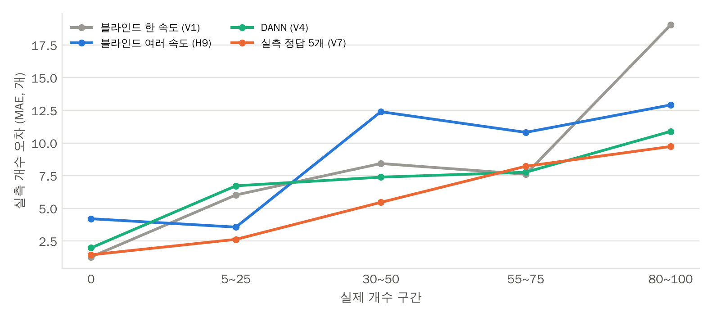
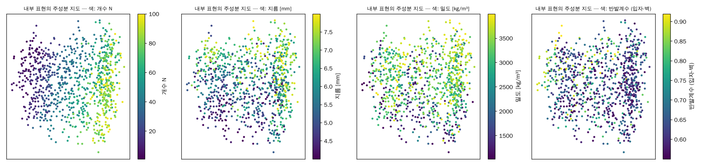
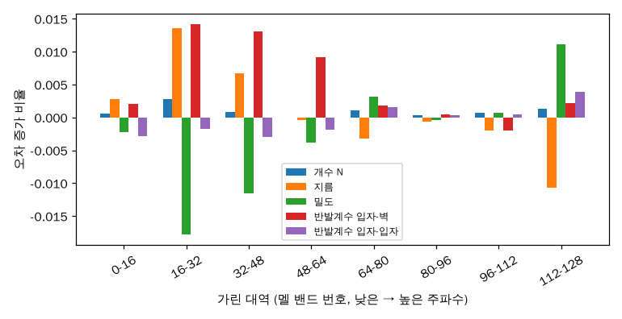

# R&E 연구보고서 — 인공지능 부분 작성본

*※ 이 파일은 양식(.hwp)에서 인공지능 담당이 채울 칸만 모은 작성본이다. 물리 분석(물리 모델, 시뮬레이션 물리 해석, 상전이·동기화·에너지 수지 해석)은 다른 팀원이 작성하므로 넣지 않았고, 필요한 곳에만 '물리 파트 참고'로 표시하였다.*

*※ 각 내용은 양식의 같은 칸(요약문·과제 수행 과정·연구보고서 Ⅰ~Ⅵ)에 그대로 옮겨 붙이면 된다. 그림과 수식은 한글 개체로 들어 있다(그림 원본: 시뮬레이터 저장소 foggyjupiter/2-2-rne-simulation의 results/). 표·그림 번호는 한글이 자동으로 매기며, 본문의 [그림 N]과 참고문헌 번호는 물리 파트 뒤로 이어지게 고친다.*

*※ 모든 수치는 학습 결과 파일(Hugging Face FoggyJupiter/rne-granular-acoustics의 experiments/, 학습 레포 outputs/)에서 직접 확인한 값이다. ‘실측’은 1차 연구 녹음(BB 6 mm, 0.12 g, 372 rpm)의 개수별 6~15번 클립 210개이며, MAE는 개수 평균 절대오차(개)이다.*

## 1. 연구결과 요약문 (인공지능 부분)

**■ 연구결과 요약문 — 인공지능 부분**

| 항목 | 내용 |
|---|---|
| 과 제 명 (제안) | 물질을 모르는 상태에서 충돌음만으로 용기 내부 입자의 개수 추정하기: 물리 시뮬레이션 기반 학습과 시뮬레이션-실측 간극 해소 (Blind estimation of particle number in a shaken container from impact sounds: simulation-trained deep learning and closing the sim-to-real gap) |
| 연구 필요성 및 목적 | 1차 연구의 합성곱 신경망(CNN)은 같은 비비탄(BB)으로 학습·평가하여 평균 절대오차 2.2개를 얻었으나, 입자의 재질이나 크기가 바뀌면 그대로 쓸 수 없다. 밀폐 용기 속 물질은 대개 알 수 없고, 물질마다 정답이 달린 녹음을 수천 개씩 모으는 것은 현실적으로 불가능하다. 본 연구의 인공지능 파트는 물리 시뮬레이터로 정답이 달린 학습 데이터를 대량으로 만들고, 시뮬레이션으로만 학습한 모델을 실제 녹음에 옮기는(sim2real) 방법을 개발하여, 물성을 모르는 상태에서도 소리만으로 개수를 추정하는 것을 목표로 한다. |
| 연구내용 및 결과 | 물성(지름·밀도·반발계수·마찰·탄성률)을 무작위로 바꾼 시뮬레이션으로 개수·물성 동시 추정 CNN을 학습하였다. 개발 단계에서 92개 비교 실험(5×5×7 cm 상자 시뮬레이션)으로 방법을 다듬은 뒤, 실제 상자 치수(바닥 7×7 cm, 높이 5 cm)로 시뮬레이터를 정정하고 실측 검증용 데이터(동역학 3,600회, 클립 1만 2,600개)를 다시 만들어 핵심 실험 17개를 다시 학습하였다(클라우드 병렬 세션 50개). ① 물질을 모르는 블라인드 모델이 실측 녹음 210개에서 개수 오차 9.8개(오차 5개 이내 38%)로, 1차 연구 방식을 같은 조건에 재현한 모델(28.1개, 19%)보다 오차를 65% 줄였다. BB만으로 학습한 '물질을 아는' 모델(9.6개)과 같은 수준이다. ② 개발 단계에서 실측 오차를 2배로 키운 원인(충돌별 세기 무작위화)을 소리만 바꾼 대조 실험으로 찾아 제거하였다(25.4→13.7개). ③ 정답 없는 실측 녹음으로 하는 도메인 적대 학습(DANN)으로 7.8개(3겹 교차검증 평균, 5개 이내 41%), 개수별 실측 정답 5개만 더하면 6.8개(47%)로 낮췄다. ④ 실제 상자로 정정하자 블라인드·DANN 모델의 실측 오차가 모두 줄었다(블라인드 13.7→9.8개, DANN 11.3→7.8개). 시뮬레이터의 기하 정확도가 실측 성능을 좌우함을 보였다. ⑤ 시드 반복·3겹 교차검증·처음 보는 물질 시험으로 재현성을 확인했고, 모델 내부 표현에서 실제 상 지표가 R² 0.95로 복원되어 모델이 고체·유체 상을 스스로 학습했음을 보였다. |
| 향후 연구계획 (요약) | ① 1차 실험 녹음으로 맞춘 음향 설정을 모두 걷어 내고, 방 잔향·직접음/잔향 비·마이크 특성 등 음향 응답을 물리적으로 가능한 범위에서 무작위화한 완전 블랙박스 학습으로 확장한다(민감도 분석 완료). ② 측정 대상 용기 하나의 녹음만으로 적응하는 DANN과, 진동수·진폭을 바꿔 얻은 여러 조건의 녹음을 종합하는 집합 모델로 정확도를 높인다. ③ 유리·금속 등 다른 재질과 여러 rpm의 실측 녹음으로 일반화를 검증한다. |
| Keyword (5개 이내) | 시뮬레이션 기반 학습(sim2real), 도메인 적대 학습(DANN), 합성곱 신경망(CNN), 개수 추정, 불확도 추정 |

## 2. 과제 수행 과정 (인공지능 부분)

**■ 과제 수행 과정 — 인공지능 부분**

| 항목 | 내용 |
|---|---|
| 외부 전문가 피드백 활용 과정 | (인공지능 파트: 외부 전문가 자문 기록 없음 — 작성 생략) |
| 문제해결 과정 | [문제 1] (개발 단계) 시뮬레이션에서는 잘 맞는 모델이 실측에서 무너짐: 실측 녹음으로 음향을 정교하게 보정한 데이터로 학습했는데, 시뮬레이션 오차 8.9개와 달리 실측 오차가 25.4개였고 개수를 체계적으로 많게 셌다(편향 +20.6개). → 원인 후보를 하나씩 분리하는 대조 실험을 설계했다. 같은 동역학에 소리만 4가지로 다시 합성해 학습한 결과(보정 전 11.5개, 실제 충돌음만 13.8개, 충돌별 세기 퍼짐만 25.9개, 둘 다 27.5개), 악화의 거의 전부가 '충돌별 세기 무작위화'에서 온다는 것을 밝혔다. 동역학을 다시 계산하지 않고 소리만 다시 합성하는 파이프라인 덕분에 몇 시간 안에 데이터를 고쳐 13.7개로 줄였다. [문제 2] 좋은 결과가 우연인지 알 수 없음: 시드만 바꾼 반복 학습(13.7/13.5개, 10.0/10.2개)과 실측 적응 녹음 묶음을 바꾸는 3겹 교차검증을 수행했다. 그 결과 1~5번 녹음으로 적응했을 때만 1~4개 낙관적이라는 것을 발견하고, 보고 수치를 3겹 평균으로 정정했다. [문제 3] (개발 단계) 적은 개수를 많게 세는 편향(5~25개 구간 +17개): 물리 파트와 원인을 공유하여(실제 벽 반발계수가 학습 범위 밖, 물리 파트 참고) 벽 반발계수 0.30~0.55의 시뮬레이션 300회를 보충했고, 블라인드 모델의 실측 오차가 13.7→11.6개로 줄었다(같은 녹음 짝 비교 −2.1개, 95% 신뢰구간 −2.7~−1.5개). 단, 벽 반발계수 추정에 같은 1차 연구 녹음이 쓰였다(보고서 Ⅴ장 한계). [문제 4] 데이터를 합친 실험이 자동 누수 검사에서 중단됨: 두 데이터셋의 실행 이름이 겹쳐 같은 실행이 학습과 평가에 동시에 들어갈 위험이 있었다. 병합 스크립트에서 이름에 출처를 붙이도록 고치고 재실행했다. 미리 만들어 둔 누수 검사가 실제로 오류를 잡아낸 사례이다. [문제 5] 계산 자원: 92개 실험을 한 컴퓨터에서 돌릴 수 없어, 실험을 나눠 클라우드 병렬 세션 60개로 수행하고 결과를 Hugging Face로 자동 수집했다. 설치 멈춤·컨테이너 재시작으로 끊긴 몫은 실험 1~2개 단위로 쪼개 다시 실행했다. [문제 6] 상자 치수 오류: 보고서 작성 중 실제 상자가 5×5×7 cm가 아니라 바닥 7×7 cm·높이 5 cm임을 확인했다. 실측과 비교하는 숫자가 모두 틀린 상자로 만든 데이터에서 나왔으므로, 시뮬레이터와 음향 보정을 정정하고 실측 검증에 필요한 데이터 4세트와 핵심 실험 17개를 다시 돌렸다. 시뮬레이션 안에서만 비교한 개발 단계 결과(원인 진단, 입력 표현, 출력 방식 등)는 같은 상자 안의 비교이므로 그대로 쓰고 '개발 단계'로 표시했다. 50개 세션이 같은 Hugging Face 계정을 쓰다가 API 한도(5분 1,000회)에 걸린 문제는, 데이터셋을 파일 하나로 묶어 내려받게 하고 끊긴 몫을 이어 받는 복구 기능을 넣어 해결했다. [해결 중인 문제] 시뮬레이터의 음향 장치 설정(마이크 게인·응답·등화기)을 1차 연구 녹음으로 맞췄기 때문에 완전한 블랙박스 조건은 아니다. 음향 파라미터별 민감도를 분석하여 물리적으로 가능한 범위의 무작위화 설계를 마련했다(향후 계획). |

**■ 생성형 AI 활용**

| 항목 | 내용 |
|---|---|
| 생성형 AI | ■ 활용함   □ 활용하지 않음 |
| 사용도구 | Anthropic Claude (Claude Code, 클라우드 병렬 세션 포함) |
| 활용목적 | 시뮬레이터·학습 코드 작성과 자동 테스트 작성, 대규모 실험(개발 단계 92개, 실제 상자 재실험 17개)과 데이터 생성의 클라우드 병렬 실행·결과 수집, 결과 분석과 그림 작성, 보고서 초안 작성 |
| 내용 | 연구 목표와 조건(물질을 모르는 조건, 추정 대상, 블랙박스 가정 등)과 연구 방향은 연구자가 정하고, 코드 작성·실험 실행·분석·초안 작성에 생성형 AI를 활용했다. 생성된 코드는 자동 테스트 82개(에너지 보존, 운동량 보존, 반발계수 재현, 데이터 누수 검사 등)로 검증했고, 결과는 시드 반복·교차검증으로 확인했으며, 보고서의 모든 수치는 저장소와 Hugging Face의 결과 파일에서 직접 확인했다. |

**■ 팀원 역할 / 과제 수행 과정에서의 학습**

| 항목 | 내용 |
|---|---|
| 팀원 역할 | (팀에서 작성) |
| 과제 수행 과정에서의 학습 (인공지능) | 첫째, 시뮬레이션에서의 성능과 실제 성능은 전혀 다를 수 있으며, 시뮬레이션에서 가장 좋은 방법이 실측에서 가장 나쁠 수도 있다는 것을 숫자로 경험했다(음량 하나만 쓰는 단순 모델이 실측에서 CNN보다 나았다). 둘째, 한 통계를 맞추려고 넣은 무작위화가 다른 통계를 망쳐 전체 성능을 무너뜨릴 수 있어, 데이터를 바꿀 때마다 대조 실험으로 효과를 분리해야 한다는 것을 배웠다. 셋째, 평가 설계(실행 단위 분할과 자동 누수 검사, 처음 보는 물질 시험, 시드 반복, 교차검증)가 모델 구조보다 결론의 신뢰도를 더 크게 좌우한다는 것을 알게 되었다. 넷째, 도메인 적대 학습, 불확도를 함께 내는 회귀, 순서형 출력(CORAL), 집합 모델 등 새로운 학습 기법과, 수십 개의 실험을 병렬로 관리하는 방법을 익혔다. 다섯째, 모델 내부 표현을 물리 지표로 해석하면서 인공지능과 물리 분석이 서로의 결과를 설명해 줄 수 있다는 것을 체감했다. |

## 3. 연구보고서 (인공지능 부분)

### 국문 초록 (인공지능 부분 문장)

**■ 국문 초록 — 인공지능 부분 (물리 파트 문장 뒤에 이어 붙임)**

| 항목 | 내용 |
|---|---|
| 국문 초록 | 인공지능 파트에서는 물성을 무작위로 바꾼 물리 시뮬레이션 충돌음으로 개수·물성 동시 추정 모델을 학습하였다. 개발 단계의 대조 실험으로 합성음 결함의 원인을 찾아 고쳤고, 실제 상자 치수로 시뮬레이터를 정정해 다시 학습한 결과, 물질을 모르는 블라인드 모델이 실측 녹음에서 개수 오차 9.8개로 1차 연구 방식(28.1개)보다 65% 정확했다. 정답 없는 실측 녹음의 도메인 적대 학습으로 7.8개, 개수별 정답 5개를 더하면 6.8개까지 낮췄다. 개수만 학습한 모델이 내부에 상 지표를 스스로 형성함을 확인하였다. 주제어(인공지능): 시뮬레이션 기반 학습, 도메인 적대 학습, 합성곱 신경망, 개수 추정, 불확도 추정 |

### Ⅰ. 서론 (인공지능 부분 단락)

밀폐된 용기를 열지 않고 내부 물체의 양을 파악하는 문제는 포장 검사, 분립체 공정 감시처럼 시각적 접근이 막힌 상황에서 자주 나타난다. 1차 연구[1]는 용기를 흔들 때 나는 충돌음만으로 내부 비비탄의 개수를 추정할 수 있음을 보였고, 웨이블릿 스케일로그램을 입력으로 한 CNN이 평균 절대오차 2.2개를 기록하였다. 그러나 이 결과는 학습과 평가에 같은 비비탄을 쓴, 즉 물질을 이미 아는 경우에만 성립한다.

실제 상황에서 용기 속 물질은 대개 알 수 없다. 소리는 개수뿐 아니라 입자의 크기, 반발계수, 질량에 따라 함께 변하므로, 물질이 바뀌면 '작은 입자 여러 개'와 '큰 입자 몇 개'가 비슷하게 들린다(물리적 근거는 물리 파트 참고). 물질마다 정답이 달린 녹음을 대량으로 모으는 것도 불가능하다. 1차 연구의 데이터(개수 21가지 × 15회)만 해도 많은 노력이 들었다.

본 연구의 인공지능 파트는 이 두 문제를 물리 시뮬레이션으로 푼다. 물성을 무작위로 바꾼 시뮬레이션으로 정답이 달린 데이터를 대량으로 만들고, 그 데이터로만 학습한 모델이 실제 녹음에서 작동하도록 시뮬레이션과 실측의 간극(sim2real gap)을 체계적으로 진단하고 줄인다. 본 파트의 기여는 다음과 같다.

첫째, 물질을 모르는 상태에서 개수와 물성을 함께 추정하는 블라인드 모델을 만들어, 처음 보는 물질에서도 1차 연구 방식보다 2배 이상 정확함을 보였다. 둘째, 소리만 바꾼 대조 실험으로 시뮬레이션-실측 간극의 원인을 찾아내는 진단 방법을 제시하고(개발 단계 실측 오차 25.4→13.7개), 실제 상자 치수로 정정한 시뮬레이션으로 블라인드 모델의 실측 오차를 9.8개까지 낮췄다. 셋째, 정답 없는 실측 녹음의 도메인 적대 학습으로 실측 오차를 7.8개까지 더 낮추었다. 넷째, 개발 단계 92개 실험과 실제 상자 재실험 17개를 같은 분할·같은 지표로 비교하고 시드 반복·교차검증·처음 보는 물질 시험으로 결과의 일반성을 확인하였다. 다섯째, 모델이 개수만 배우면서 내부에 상(相) 지표를 스스로 형성했음을 보여 인공지능 결과를 물리적으로 해석하였다.

### Ⅱ. 이론적 배경 — 2. 인공지능 관련 이론적 배경

*※ 스펙트로그램·멜 척도·CNN의 기초는 1차 연구 보고서 2장과 같아 생략한다. 여기서는 Ⅳ장의 결과를 해석하는 데 필요한 개념만 정리한다. 시뮬레이터(DEM·충돌음 합성)의 이론은 물리 파트 참고.*

#### 2.1 시뮬레이션 기반 학습과 시뮬레이션-실측 간극

신경망은 정답을 맞히는 데 도움이 되는 단서라면 무엇이든 쓴다. 시뮬레이션을 쓰면 정답(개수와 물성)이 정확히 달린 데이터를 원하는 만큼 만들 수 있지만, 시뮬레이션 소리와 실제 녹음은 완전히 같지 않다. 이 차이를 시뮬레이션-실측 간극(sim2real gap)이라 한다. 모델이 시뮬레이션에서만 성립하는 단서(예: 합성음 특유의 세기 변화)에 기대어 개수를 세었다면, 시뮬레이션 평가에서는 아주 잘 맞아도 실제 녹음에서는 크게 틀린다.

이론적으로도 실측 오차는 '시뮬레이션 오차'와 '두 소리 분포 사이의 차이'의 합을 넘지 않는다[2].

$$\varepsilon_{\text{실측}} \le \varepsilon_{\text{시뮬}} + d(\text{시뮬},\ \text{실측}) + \lambda$$

여기서 ε은 각 영역에서의 개수 오차, d는 모델이 보는 단서로 따진 두 소리 분포의 차이, λ는 두 영역 모두에서 잘 맞는 이상적인 모델도 피할 수 없는 오차이다. 따라서 실측 성능을 높이는 길은 두 가지이다. 하나는 시뮬레이션 소리를 실제에 가깝게 만들어 분포 차이를 줄이는 것이고, 다른 하나는 모델이 두 영역에서 똑같이 보이는 단서만 쓰도록 만드는 것이다. 이 관점에서 보면 '시뮬레이션에서 가장 좋은 모델'이 '실측에서 가장 좋은 모델'이 아닐 수 있으며, Ⅳ장에서 실제로 그런 경우들이 나타난다.

#### 2.2 도메인 무작위화

도메인 무작위화[3]는 정확히 알 수 없는 조건(입자의 물성, 마이크 게인, 잔향, 잡음 크기, 충돌음의 모양 등)을 학습 데이터에서 넓게 바꾸는 방법이다. 실제 환경이 학습 데이터의 다양성 안에 들어오면, 모델은 실측 녹음을 '또 하나의 변형'으로 처리할 수 있다. 본 연구에서 '물질을 모르는 모델'이 가능한 것도 물성을 무작위로 바꾼 데이터로 학습했기 때문이다. 다만 무작위화가 현실에 없는 소리를 만들면, 모델은 그 비현실적인 변화를 단서로 배우게 되어 오히려 실측 성능이 떨어진다. Ⅳ-2.2의 원인 진단 실험이 바로 이 경우이다.

#### 2.3 도메인 적응: 정답 없는 실측 녹음과 소량의 정답

도메인 적대 학습(DANN)[4]은 정답(개수)이 없는 실측 녹음을 학습에 함께 쓰는 방법이다. 모델에 '이 소리가 시뮬레이션인가 실측인가'를 맞히는 판별기를 붙이고, 모델의 특징 추출 부분은 판별기가 이를 가려내지 못하도록 학습한다. 그러면 모델 내부에서 시뮬레이션 특유의 단서가 지워지고, 두 영역 모두에서 통하는 단서로 개수를 세게 된다. 측정 대상을 흔든 녹음만 있으면 되므로, 정답을 알 수 없는 실제 상황에도 쓸 수 있다는 것이 장점이다.

이와 비교하기 위해, 정답이 붙은 실측 녹음을 개수별로 1~5개만 시뮬레이션 데이터에 섞어 학습하는 경우도 시험하였다. 이는 '몇 개 넣었는지 아는 녹음을 조금 만들 수 있는' 상황에 해당하며, 시뮬레이션이 주는 일반성과 실측이 주는 정확성을 함께 얻으려는 방법이다.

#### 2.4 물질과 개수의 혼동, 그리고 정보의 한계

충돌음은 개수뿐 아니라 입자의 크기, 질량, 반발계수에 따라 함께 변한다. 그래서 물질을 모르면 '작은 입자 여러 개'와 '큰 입자 몇 개'가 비슷하게 들리는 혼동이 생긴다(물리적 근거는 물리 파트 참고). 이 혼동은 모델을 아무리 잘 만들어도 완전히 없앨 수 없는 원리적인 한계이다. 통계학의 크라메르-라오 하한[5]은 관측 자료에 담긴 정보량으로부터 '어떤 추정 방법으로도 넘을 수 없는 오차의 최솟값'을 알려 주는데, 물성을 함께 추정해야 하면 개수에 대한 정보 일부가 물성과 겹쳐 사라지므로 이 최솟값이 커진다. 반대로 지름이나 무게처럼 실제로 잴 수 있는 물성을 모델에 알려 주면 혼동이 줄어든다. Ⅳ-2.3은 이 혼동이 실제로 얼마나 큰지, 어떤 물성을 알려 줄 때 줄어드는지를 보인다.

#### 2.5 여러 가진 조건을 종합하는 집합 모델

녹음 하나만으로는 개수와 물성의 효과를 가르기 어렵지만, 같은 용기를 여러 가진 속도로 흔들면 두 효과가 조건마다 다르게 변한다. 가진을 세게 할 때 소리가 변하는 방식이 입자의 크기·반발계수에 따라 다르므로, 조건 사이의 변화를 보면 물성에 대한 정보를 더 얻을 수 있다. 이런 녹음 묶음을 한꺼번에 받아 종합하는 모델을 집합 모델이라 한다[6,7]. 집합 모델은 녹음의 순서나 수에 상관없이 작동하므로, 녹음이 하나뿐인 실측에도 그대로 쓸 수 있다. 또 묶음 전체에 공통인 음량을 기준으로 삼으면, 마이크 게인처럼 모든 녹음에 똑같이 곱해지는 미지의 배율을 지울 수 있다.

#### 2.6 일반화의 검증

모델이 정말로 개수를 세는 법을 배웠는지 확인하려면, 학습에 쓴 것과 다른 데이터에서 평가해야 한다. 본 연구는 네 가지를 확인하였다. 첫째, 데이터 누수 방지: 같은 시뮬레이션 실행에서 나온 소리가 학습과 평가에 동시에 들어가면 성능이 부풀려지므로 실행 단위로 나눈다. 둘째, 처음 보는 물질(분포 밖, OOD) 시험: 특정 물성 영역을 학습에서 통째로 빼고 그 영역에서 평가한다. 셋째, 시드 반복: 무작위 초기값만 바꿔 다시 학습했을 때 결과가 얼마나 흔들리는지 보아, 실험 사이의 차이가 우연보다 큰지 판단한다. 넷째, 교차검증: 실측 녹음 중 적응·학습에 쓰는 묶음과 평가에 쓰는 묶음을 돌아가며 바꿔, 특정 녹음 묶음에만 유리한 결과가 아닌지 확인한다.

#### 2.7 불확도와 예측 구간

물질을 모르면 같은 소리에 여러 개수가 대응할 수 있으므로, 추정값 하나만 내는 것보다 '얼마나 확신하는지'를 함께 내는 것이 측정 도구로서 더 정직하다. 본 연구의 모델은 개수의 추정값과 함께 불확도(표준편차)를 출력하도록 학습하여[8,9], 헷갈리는 입력에서는 불확도를 크게 낸다. 학습 뒤에는 검증 데이터로 불확도의 크기를 맞춰 '90% 확률로 정답이 이 구간 안에 있다'는 예측 구간을 만든다(컨포멀 예측[10]).

$$\hat{N} - q\,\hat{\sigma} \le N \le \hat{N} + q\,\hat{\sigma}$$

여기서 N̂은 추정값, σ̂은 불확도, q는 검증 데이터에서 정답의 90%가 구간 안에 들도록 정한 배수이다. 이 구간이 실제로 정답을 90% 가까이 포함하면 불확도를 믿을 수 있다는 뜻이고, 포함률이 크게 낮으면 모델이 실제보다 과신하고 있다는 뜻이다.

#### 2.8 모델이 배운 것을 들여다보는 방법: 선형 탐침

신경망은 입력을 여러 층에 걸쳐 변환해 마지막에 숫자 묶음(내부 표현)으로 요약한 뒤 답을 낸다. 선형 탐침[11]은 이 내부 표현에서 어떤 물리량을 단순한 선형 회귀만으로 얼마나 정확히 복원할 수 있는지(R²)를 재는 방법이다.

$$R^2 = 1 - \frac{\sum_i (y_i - \hat{y}_i)^2}{\sum_i (y_i - \bar{y})^2}$$

여기서 y는 실제 물리량, ŷ은 내부 표현에서 선형 회귀로 복원한 값, ȳ은 y의 평균이다. R²가 1에 가까우면 모델이 그 물리량을 내부에 분명하게 담고 있다는 뜻이다. 특히 모델에게 가르친 적 없는 물리량이 높게 복원되면, 모델이 문제를 풀기 위해 그 개념을 스스로 만들어 냈다고 해석할 수 있다.

### Ⅲ. 연구 방법 및 절차 — 2. 인공지능 연구 방법

#### 2.1 전체 흐름

인공지능 파트는 ① 물리 시뮬레이터로 물성을 무작위로 바꾼 학습 데이터를 만들고, ② 소리에서 시간-주파수 영상과 물리 특징을 뽑아, ③ 개수와 물성을 불확도와 함께 출력하는 CNN을 학습한 뒤, ④ 시뮬레이션의 새 실행, 학습에 없던 물질, 1차 연구의 실제 녹음으로 평가하는 순서로 진행하였다. 시뮬레이터는 동역학 결과(충돌 목록, 벽 힘)를 저장하므로, 동역학을 다시 계산하지 않고 소리만 몇 초 만에 다시 합성할 수 있다. 이 기능이 Ⅳ-2.2의 원인 진단 실험을 가능하게 했다.

{width=95%}

#### 2.2 학습 데이터

학습 데이터는 모두 물리 시뮬레이터로 만들었다(시뮬레이터의 물리 모델과 검증은 물리 파트 참고). 실행마다 개수 N(0~100)과 물성 7가지를 범위 안에 고르게 퍼지도록 무작위로 정하고(라틴 하이퍼큐브 추출[12]), 같은 동역학에서 녹음 조건(마이크 게인 ±3 dB, 직접음/잔향 비, 잡음 크기, 합성/실제 충돌음)을 바꿔 소리를 4번 합성하였다. 물성 범위는 실제로 구할 수 있는 입자(무게가 다른 6 mm BB, 8 mm BB, 플라스틱 구슬)를 포함하도록 지름 4~8 mm, 밀도 1000~4000 kg/m³, 반발계수 0.55~0.97(입자-벽은 0.92까지), 마찰계수 0.1~0.5, 탄성률 1.5~5 GPa로 정하였다. 같은 개수·다른 물성, 같은 물성·다른 개수인 짝도 만들어, 물성이 바뀌어도 개수 예측이 흔들리지 않도록 하는 데 썼다. 모든 데이터는 Hugging Face 데이터셋(FoggyJupiter/rne-granular-acoustics)에 올려 병렬 세션들이 함께 썼다.

| 데이터셋 | 내용 | 규모 | 용도 |
|---|---|---|---|
| v1 (보정 전) | 372 rpm 고정, 합성 충돌음만 | 실행 1,600 × 녹음 조건 4 = 6,400 클립 | 보정 전후 비교 (R) |
| v3 (주 데이터) | 실측 보정 반영: 357~387 rpm, 충돌별 세기 퍼짐 σ 0~1.5, 합성/실제 충돌음 반반 | 6,400 클립 | 블라인드 학습·평가 (A, B, C, D, E, F, G, K, S) |
| v1_r2 / v1_sig / v1_clk | v1 동역학에 소리만 재합성 (보정 소리 / 세기 퍼짐만 / 실제 충돌음만) | 각 6,400 클립 | 실측 악화 원인 진단 (R, W) |
| v3_nosig | v3에서 세기 퍼짐만 0으로 재합성 | 6,400 클립 | 원인을 제거한 주 데이터 (V, Q) |
| bb_fixed | BB 크기·무게 고정, 나머지 물성 무작위 | 300 × 4 = 1,200 클립 | 1차 연구식 '물질을 아는' 모델 (A5) |
| multi_rpm (v2) | 같은 계를 300/372/450/550/650 rpm으로 (Γ 1.35~6.3) | 계 440 × 속도 5 × 3 = 6,600 클립 | 여러 가진 속도 집합 모델 (H1~H8) |
| multi_rpm_nosig | v2에서 세기 퍼짐 0으로 재합성 | 6,600 클립 | 집합 모델 (H9~H11), 데이터 합치기 (U) |
| lowe (보충) | v3 설계에 벽 반발계수만 0.30~0.55 | 300 × 4 = 1,200 클립 | 물리 진단을 반영한 보충 (L) |

**표 1. 학습·평가에 사용한 시뮬레이션 데이터셋**

*※ 위 데이터는 개발 단계(5×5×7 cm 상자)의 것이다. 합계 DEM 동역학 실행 약 6,000회, 합성 클립 약 54,000개. 음향 장치 특성(마이크 게인, 응답, 등화기)은 1차 연구 녹음으로 보정하였다(한계는 Ⅴ장 참고).*

개발이 끝난 뒤 실제 상자가 바닥 7×7 cm, 높이 5 cm임을 확인하고(개발 단계는 5×5×7 cm로 잘못 설정), 시뮬레이터 치수와 음향 보정을 정정하였다. 새 상자에서 다시 맞춘 마이크 게인은 0.924로 예전(0.92)과 같았고, 등화기만 새로 맞췄다. 그다음 실측 검증에 필요한 데이터 4세트(주 데이터, 여러 가진 속도, BB 고정, 벽 반발 보충)를 같은 설계로 다시 만들었다. 세기 퍼짐은 처음부터 0으로 두었고, 효과가 없던 대조 쌍은 뺐다. 모두 동역학 3,600회, 클립 1만 2,600개이며 클라우드 세션 34개로 약 30분 만에 생성하였다. Ⅳ장의 실측 성능은 이 데이터로 다시 학습한 결과이다.

| 데이터셋 | 내용 | 규모 | 용도 |
|---|---|---|---|
| 주 데이터 | v3_nosig와 같은 설계 (372 rpm ±4 %, 세기 퍼짐 0) | 실행 1,200 × 4 = 4,800 클립 | 블라인드·DANN·실측 정답 (V, Q, F) |
| 여러 가진 속도 | 계 360개 × 300~650 rpm 5가지 | 1,800 × 3 = 5,400 클립 | 집합 모델 (H9, H11) |
| BB 고정 | BB 크기·무게 고정 | 300 × 4 = 1,200 클립 | 기준선 (A4, A5) |
| 벽 반발 보충 | 벽 반발계수 0.30~0.55 | 300 × 4 = 1,200 클립 | 물리 진단 반영 (L1) |

**표 2. 실제 상자(7×7×5 cm)로 다시 만든 데이터**

#### 2.3 실측 평가 데이터와 데이터 누수 방지

실측 평가는 1차 연구 녹음(BB 6 mm·0.12 g, 372 rpm, N = 0~100의 21가지 × 15회 = 315개)으로 하였다. 개수마다 1~5번 녹음은 실제 충돌음 추출, 도메인 적응, 실측 정답 학습에만 쓰는 개발용으로 두고, 6~15번 녹음 210개는 어떤 실험에서도 학습에 쓰지 않고 평가에만 썼다. 시뮬레이션 데이터는 실행(다중 조건은 계) 단위로 학습 80% / 검증 10% / 평가 10%로 나누어, 같은 실행의 다른 녹음 조건이 학습과 평가에 동시에 들어가지 않게 했고, 학습 시작마다 분할 누수를 자동 검사하였다. 또 밀도 2800~4000 kg/m³이면서 벽 반발계수 0.55~0.68인 영역은 학습에서 통째로 빼서 '처음 보는 물질(OOD)' 시험에 썼다(실행 142개, 568 클립).

#### 2.4 입력 표현

입력은 1차 연구처럼 두 갈래이다. 첫째는 로그-멜 스펙트로그램으로, 1차 연구의 22.05 kHz 리샘플이 버리던 11~24 kHz 대역(충돌음 에너지의 대부분이 8~24 kHz에 있음)까지 살리도록 48 kHz 녹음을 그대로 썼다. 둘째는 물리 특징 220개로, 1차 연구식 특징 12개(음량, 주기성, 첨도 등), 가진 주기에 맞춰 소리 세기가 얼마나 규칙적으로 오르내리는지를 대역별로 나타낸 특징 192개, 대역별 첨도 16개이다. 실제 가진 속도가 녹음마다 6.04~6.64 Hz로 달랐기 때문에(물리 파트 참고), 공칭 주파수가 아닌 녹음별 추정 주파수로 주기 구조를 계산한 것이 중요했다. 비교를 위해 타악 성분 분리(HPSS), 모터 잡음 제거, 22 kHz 멜(1차 연구 방식), 웨이블릿 스케일로그램, 6~24 kHz 대역만 쓰는 입력도 시험하였다.

#### 2.5 모델 구조

기본 모델(CountNet)은 1차 연구의 'CNN + 물리 특징 융합' 구조를 이어받았다. 합성곱 층 4단으로 스펙트로그램을 요약한 뒤 물리 특징과 합쳐, 개수와 물성 8가지(지름, 밀도, 질량, 입자끼리·입자-벽 반발계수, 입자끼리·입자-벽 마찰, 탄성률)를 각각 추정값과 불확도로 출력한다. 물성은 어떤 경우에도 입력으로 넣지 않고 출력(추정 대상)으로만 쓴다(물성을 '알려 주는' 비교 실험만 예외). 실측 적응을 할 때는 모델 내부 표현 뒤에 시뮬레이션/실측 판별기를 붙인다. 모델 크기는 1차 연구처럼 GPU 없이도 실험 하나를 약 1시간에 학습할 수 있도록 파라미터 약 78만 개로 정하였다.

다중 조건 모델(SetCountNet)은 같은 계를 여러 가진 속도로 녹음한 소리 묶음을 받는다. 각 녹음을 같은 CountNet으로 처리하고, 녹음마다 가진 세기 Γ를 함께 알려 준 뒤, 녹음들을 서로 비교하며 하나로 종합한다. 가진 세기가 이웃한 조건 사이의 변화도 따로 모아 쓰고, 묶음 공통의 음량을 빼서 마이크 게인·입자 질량처럼 모든 조건에 공통인 배율을 지운다. 녹음이 하나뿐인 실측은 '녹음 1개짜리 묶음'으로 같은 모델에 넣는다.

{width=95%}

#### 2.6 학습 방법

손실은 개수 오차, 물성 오차, 불확도 항을 기본으로 하고, 같은 개수·다른 물성 짝의 예측을 같게 만드는 항과 같은 물성 짝에서 개수의 크기 순서를 지키게 하는 항을 더했다. 실측 적응 때는 판별기를 속이는 항을 더하되, 그 비중을 학습 초반 0에서 서서히 키워 개수 세는 법을 먼저 배운 뒤 영역 차이를 줄이도록 하였다. 데이터 증강으로 녹음의 일부 구간만 잘라 쓰기, 시간·주파수 일부 가리기(SpecAugment[13]), ±3 dB 무작위 음량 변화를 써서 모델이 절대 음량 하나에만 기대지 못하게 하였고, 평가 때는 여러 구간의 예측을 평균했다. 실측 적응(DANN)은 학습 배치마다 정답 없는 실측 클립을 섞었고, 실측 정답 학습은 정답 붙은 실측 클립을 여러 번 반복해 시뮬레이션 데이터에 섞어 처음부터 함께 학습하였다.

개수 출력 방식은 네 가지를 비교하였다. 개수를 연속값으로 바로 내는 회귀, 0~100을 구간으로 나눠 확률을 내는 분류(1차 연구 방식), 정답 주변 구간에도 확률을 나눠 주어 인접한 오답을 덜 벌하는 소프트 라벨 분류, 'N이 k보다 큰가'를 여러 번 묻는 순서형 분류(CORAL[14])이다.

#### 2.7 평가 방법

모든 실험은 같은 분할, 같은 지표로 평가하였다. 주 지표는 개수 평균 절대오차(MAE)와 편향이다.

$$\mathrm{MAE} = \frac{1}{n}\sum_{i=1}^{n} \left| \hat{N}_i - N_i \right|$$

$$\text{편향} = \frac{1}{n}\sum_{i=1}^{n} (\hat{N}_i - N_i)$$

여기서 N_i는 i번째 녹음의 실제 개수, N̂_i는 예측 개수, n은 평가 녹음 수이다. MAE는 평균적으로 몇 개 틀리는지를, 편향은 개수를 많게(양수) 또는 적게(음수) 세는 경향을 나타낸다. 이와 함께 오차 5개·10개 이내 비율, 90% 예측 구간의 실제 포함률, 물성 추정 R², 개수 오차와 지름 오차의 상관(혼동 진단), 개수 구간별 오차를 기록하였다.

실측 녹음의 가진 속도는 녹음마다 6.04~6.64 Hz로 흔들렸으므로, 예측이 이 흔들림에 얼마나 휘둘리는지도 쟀다(속도 민감도). 개수 자체의 영향이 섞이지 않도록 같은 개수의 녹음끼리 평균을 뺀 뒤, 예측 오차를 녹음별 가진 주파수에 회귀한 기울기로 정의하였다.

$$S = \frac{\sum_i (f_i - \bar{f}_{N_i})(e_i - \bar{e}_{N_i})}{\sum_i (f_i - \bar{f}_{N_i})^2},\quad e_i = \hat{N}_i - N_i$$

여기서 f_i는 녹음에서 추정한 가진 주파수, 윗줄(f̄, ē)은 같은 개수 녹음들의 평균이다. S의 단위는 개/Hz이며, 0에 가까울수록 가진 속도의 흔들림에 강건하다. 결과의 우연성을 보기 위해 시드 반복, 실측 적응 녹음 묶음을 바꾸는 3겹 교차검증, 같은 녹음끼리 짝지은 비교를 하였다. 평가에 쓴 6~15번 녹음은 결과를 보고 설정을 다시 맞추는 데 쓰지 않았다(예외는 Ⅴ장 한계 참고).

#### 2.8 실험 설계와 병렬 수행

연구 질문마다 실험 묶음을 정해 모두 92개 실험을 설계하였고, 데이터 생성 6개와 학습·분석 54개를 합쳐 클라우드 병렬 세션 60개로 나눠 수행하였다. 각 세션은 Hugging Face에서 필요한 데이터만 받아 맡은 실험을 돌리고 결과(지표, 예측, 모델)를 다시 올렸으며, 결과가 모이면 한 곳에서 같은 표로 정리하였다.

| 몫 | 실험 수 | 실험 | 질문 |
|---|---|---|---|
| M0 | 12 | A4, A5, R0~R4, B9~B12 | 1차 연구 방식 재현, 물질 고정 학습, 음향 보정 전후, 실측 통과 성분 선택 |
| M1a | 8 | A1~A3, C1, G1·G2·G5, S | 물성을 알려 주면? 정답 없는/있는 실측 녹음을 쓰면? |
| M1b | 7 | C2~C5, S (시드 반복) | 구성 요소 제거, 재현성 |
| M2 | 21 | F 6개, B1~B8, E1~E3, D 4개 | 딥러닝 없는 기준선, 입력 표현, 일반화, 개수 출력 방식 |
| M3 | 8 | H1~H8 | 여러 가진 속도 집합 모델의 설계 |
| M4 | 8 | K1~K8 | 어떤 물성을 알려 주면 도움이 되나 |
| M5 | 2 | W1, W2 | 보정한 소리가 실측에서 나빠진 원인 |
| M6·M7 | 11 | V1~V11 | 원인을 제거한 데이터로 재학습, 시드 반복 |
| M8 | 3 | H9~H11 | 원인을 제거한 여러 속도 데이터 |
| M9 | 6 | Q1~Q6 | 실측 적응 녹음 묶음을 바꾼 교차검증 |
| M10 | 3 | U1~U3 | 단일·여러 속도 데이터를 한 클립씩 합치기 |
| M11 | 3 | L1~L3 | 물리 진단(벽 반발계수)을 반영한 보충 데이터 |

**표 3. 실험 묶음과 수행 몫 (총 92개)**

### Ⅳ. 연구 결과 — 2. 인공지능 연구 결과

#### 2.1 실제 상자로 한 최종 실측 검증: 기준선 대비 성능

아래 표와 [그림 3]은 실제 상자(바닥 7×7 cm, 높이 5 cm)로 다시 만든 데이터로 학습한 모델들을 1차 연구 녹음 210개(개수별 6~15번)로 평가한 결과이다. 기준선은 1차 연구 방식을 같은 데이터에 재현한 모델(A4: BB만 학습, 22 kHz 멜, 21단계 분류), BB만 학습한 본 모델(A5, 물질을 아는 경우), 음량 하나만 쓰는 회귀, 손으로 만든 특징의 그래디언트 부스팅이다. 오른쪽 열은 같은 실험을 개발 단계의 잘못된 상자(5×5×7 cm)로 했을 때의 실측 오차이다.

| 구분 | 모델 (실험) | 시뮬레이션 test | 처음 보는 물질 | 실측 MAE | 실측 ±5 | 5×5×7 상자 실측 |
|---|---|---|---|---|---|---|
| 기준선 | 1차 연구 방식 재현, BB만 학습 (A4) | 13.2 | 15.5 | 28.1 | 19% | 29.4 |
| 기준선 | BB만 학습한 본 모델, 물질을 앎 (A5) | 10.1 | 10.3 | 9.6 | 41% | 18.5 |
| 기준선 | 음량 하나만 회귀 (F) | 18.2 | 19.7 | 18.5 | 15% | 18.5 |
| 기준선 | 손특징 + 그래디언트 부스팅 (F) | 9.1 | 11.0 | 18.9 | 15% | 27.3 |
| 블라인드 | 한 가진 속도 (V1) | 5.8 | 6.6 | 9.8 | 38% | 13.7 |
| 블라인드 | 여러 가진 속도 집합 모델 (H9) | 6.6 | 9.2 | 9.6 | 40% | 11.2 |
| 블라인드 | V1 + 벽 반발계수 보충 데이터 (L1) | 6.5 | 6.7 | 9.5 | 33% | 11.6 |
| +정답 없는 실측 | V1 + DANN (V4·Q3·Q4, 3겹 평균) | 7.4 | 8.4 | 7.8 (7.9/7.6/8.0) | 41% | 11.3 |
| +정답 없는 실측 | V1 + DANN + 실제로 잰 크기·무게 (V8·Q5·Q6) | 5.8 | 7.0 | 8.9 (10.3/8.0/8.4) | 33% | 9.8 |
| +정답 없는 실측 | H9 + DANN (H11) | 6.9 | 8.7 | 14.7 | 21% | 9.1 |
| +실측 정답 소량 | V1 + 개수별 실측 정답 5개 (V7·Q1·Q2) | 6.3 | 6.9 | 6.8 (6.3/5.8/8.3) | 47% | 6.3 |

**표 4. 실제 상자로 학습한 모델의 개수 추정 성능 (MAE, 개; ±5는 오차 5개 이내 비율)**

*※ '블라인드'와 '+정답 없는 실측' 행은 모델에 물성을 알려 주지 않았고, 블라인드 행은 학습에 실측 녹음을 넣지 않은 결과이다. 단, 시뮬레이터의 음향 장치 설정은 1차 연구 녹음으로 보정하였다(Ⅴ-4). 괄호 안은 교차검증 세 묶음 각각의 값이다.*

{width=95%}

가장 중요한 결과는 다음 세 가지이다. 첫째, 물질을 모르는 블라인드 모델이 실측 녹음에서 개수 오차 9.6~9.8개(오차 5개 이내 38~40%)로, 1차 연구 방식(28.1개, 19%)보다 오차를 약 65% 줄였다. BB만으로 학습한 '물질을 아는' 모델(A5, 9.6개)과 같은 수준으로, 물질 정보 없이도 물질을 아는 경우만큼 개수를 셀 수 있음을 보였다. 둘째, 정답 없이 측정 대상을 흔든 녹음만 있으면 되는 도메인 적대 학습으로 7.8개(5개 이내 41%)까지 낮췄고, 교차검증 세 묶음이 7.6~8.0개로 고르게 나와 안정적이었다. 셋째, 개수별 정답 녹음 5개만 더하면 6.8개(47%)였다. 1차 연구가 개수별 녹음 12개씩을 정답과 함께 학습해 얻은 2.2개와 비교하면, 본 연구는 훨씬 적은 실측 정보로 '물질을 모르는 모델'을 실측에 맞춘 셈이다.

상자를 실제 치수로 고치자 블라인드와 DANN 모델의 실측 오차가 모두 줄었다(V1 13.7→9.8개, H9 11.2→9.6개, DANN 11.3→7.8개). 시뮬레이션 안의 성능은 비슷했으므로(V1 test 6.8→5.8개), 줄어든 몫은 시뮬레이션과 실제의 차이가 줄어든 데서 왔다. 바닥 넓이가 2배가 되면 같은 개수에서 입자 층 수가 절반이 되어 충돌 양상이 달라지므로(물리 파트 참고), 시뮬레이터의 기하가 정확해야 실측으로 옮겨진다는 뜻이다. 한편 1차 연구 CNN의 2.2개는 같은 BB 녹음으로 학습·평가한 값이어서, 물질을 모르는 본 연구의 수치와 직접 비교할 수는 없다. 같은 조건에서 1차 연구 방식을 재현한 A4(28.1개)가 공정한 기준선이다.

#### 2.2 개발 단계: 실측 성능 악화의 원인 규명과 해결

*※ 2.2·2.3·2.6·2.7·2.11절은 개발 단계(5×5×7 cm 상자 시뮬레이션)의 결과이다. 같은 상자 안에서 조건만 바꿔 비교한 것이므로 비교의 결론은 유효하며, 실측 수치는 상자 정정 전의 값이다.*

1차 연구 녹음으로 음향을 정교하게 보정한 데이터(v3)로 학습했는데, 실측 오차가 보정 전 데이터(11.5개)보다 오히려 커졌다(25.4개). 원인 후보는 동역학 보정, 실제 충돌음 삽입, 충돌별 세기 무작위화(세기 퍼짐) 세 가지였다. 이를 가르기 위해 같은 동역학(v1)에 소리만 바꿔 다시 합성하고 같은 모델을 학습하는 대조 실험을 설계하였다(아래 표).

| 학습한 소리 | 실험 | 시뮬레이션 test | 실측 MAE | 실측 편향 | N 5~25 편향 | N 30~50 편향 |
|---|---|---|---|---|---|---|
| 보정 전 소리 | R0 | 7.5 | 11.5 | +0.4 | +8.4 | +13.2 |
| + 실제 충돌음만 | W2 | 6.2 | 13.8 | +7.3 | +15.4 | +20.6 |
| + 충돌별 세기 퍼짐만 | W1 | 7.8 | 25.9 | +21.7 | +47.9 | +37.2 |
| + 둘 다 (= 보정한 소리) | R1 | 8.2 | 27.5 | +22.7 | +51.0 | +37.4 |

**표 5. 소리만 바꾼 원인 진단 실험 (같은 동역학, 블라인드 모델)**

{width=95%}

실측 악화의 거의 전부(11.5→25.9개)가 충돌별 세기 퍼짐에서 왔다. 세기 퍼짐은 진폭 분포의 뾰족함(첨도)을 실측에 맞추려고 넣었지만, 고음 대역 소리 세기의 시간 변화를 불규칙하게 만들어 모델이 '적은 개수 = 매우 불규칙'을 배우게 했고, 덜 불규칙한 실측을 많은 개수로 읽게 했다(N 5~25 편향 +48개). 학습 없이 특징 회귀로 같은 실험을 해도 11.5 / 26.2 / 12.8개로 같은 결론이 나왔다. '한 통계를 맞추려고 넣은 무작위화가 다른 통계를 틀어 전이를 망칠 수 있다'는 것은 도메인 무작위화를 쓰는 연구 전반에 주는 교훈이다.

원인을 확인한 뒤, 동역학과 다른 녹음 조건은 그대로 두고 세기 퍼짐만 0으로 소리를 다시 합성한 데이터(v3_nosig)로 같은 실험들을 반복하였다(아래 표). 시뮬레이션과 실측 성능이 함께 좋아졌다.

| 실험 | 세기 퍼짐 있음 (v3): test / 실측 | 세기 퍼짐 없음 (v3_nosig): test / OOD / 실측 | 실측 ±5 |
|---|---|---|---|
| 블라인드 | 8.9 / 25.4 (A1) | 6.8 / 6.9 / 13.7 (V1) | 15% → 19% |
| 크기·무게 앎 | 6.8 / 17.2 (A2) | 5.1 / 5.4 / 11.5 (V2) | 17% → 20% |
| 물성 전부 앎 | 4.8 / 20.6 (A3) | 4.0 / 4.4 / 13.9 (V3) | 15% → 14% |
| DANN | 10.1 / 14.1 (C1) | 6.9 / 7.2 / 10.0 (V4) | 18% → 39% |
| HPSS + 잡음 제거 + DANN | 9.5 / 17.9 (B8) | 7.0 / 7.3 / 12.3 (V5) | 16% → 20% |
| 실측 정답 1 / 2 / 5개 | 9.7 / 7.8 / 5.9 (G) | 9.2 / 7.4 / 6.2 (V11·V6·V7) | 53% → 53% (5개) |

**표 6. 세기 퍼짐 제거 전후 (MAE, 개)**

{width=95%}

블라인드 모델의 실측 오차가 25.4→13.7개로 거의 절반이 되었고, 시뮬레이션 오차도 모든 실험에서 20~30% 줄었다(8.9→6.8개). 세기 퍼짐은 실측 전이뿐 아니라 시뮬레이션 안에서도 개수 단서를 흐리는 잡음이었던 것이다.

#### 2.3 개발 단계: 물성 정보의 효과와 '작은 입자 여러 개 vs 큰 입자 몇 개' 혼동

| 알려 준 물성 | 실험 | 시뮬레이션 test | 처음 보는 물질 | 실측 MAE |
|---|---|---|---|---|
| 없음 (블라인드) | A1 | 8.9 | 9.1 | 25.4 |
| 지름 | K1 | 7.4 | 8.1 | 18.7 |
| 질량 | K2 | 7.8 | 7.8 | 21.1 |
| 밀도 | K3 | 9.1 | 9.5 | 25.5 |
| 지름 + 질량 | K4 | 7.5 | 7.8 | 19.5 |
| 지름·밀도·질량 | A2 | 6.8 | 7.5 | 17.2 |
| 반발계수 (시뮬레이션 비교로 추정한 값) | K5 | 8.8 | 9.0 | 30.4 |
| 마찰 / 탄성률 | K6 / K7 | 10.0 / 8.8 | 10.0 / 8.8 | 24.5 / 26.3 |
| 크기·무게 + 반발계수 | K8 | 4.8 | 4.9 | 23.4 |
| 8가지 전부 | A3 | 4.8 | 4.8 | 20.6 |

**표 7. 모델에 알려 준 물성에 따른 성능 (주 데이터 v3)**

시뮬레이션에서는 물성을 알려 줄수록 좋아졌다(블라인드 8.9 → 크기·무게 6.8 → 전부 4.8개). 하나만 줄 때는 지름이 가장 도움이 되었다. 블라인드 모델의 개수 오차와 지름 오차의 상관은 −0.44로, 지름을 작게 보면 개수를 많게 보는 '작은 입자 여러 개 vs 큰 입자 몇 개' 혼동이 있었는데, 지름·무게를 알려 주면 상관이 +0.06(A2), +0.07(K1)로 사라졌다. 물성을 알려 주는 효과는 바로 이 혼동을 없애는 것이다. 실측에서는 실제로 잰 지름·무게를 줄 때만 좋아졌고(25.4→17.2개), 추정한 반발계수나 모르는 탄성률을 넣으면 오히려 나빠졌다(K5 30.4개). 정확히 아는 물성만 알려 줘야 한다는 실용적 지침을 얻었다. 학습 없이 계산한 크라메르-라오 하한도 물질을 모르면 물질을 알 때보다 약 2.3~2.6배 커서(예: N 1~19에서 3.3개 → 7.5개), 같은 결론을 이론적으로 뒷받침한다.

#### 2.4 정답 없는 실측 적응(DANN)과 소량의 실측 정답 (실제 상자)

| 실측 녹음 사용 | 1~5번 사용 | 6~10번 사용 | 11~15번 사용 | 평균 MAE | 평균 ±5 |
|---|---|---|---|---|---|
| 쓰지 않음 (V1) | 9.8 | – | – | 9.8 | 38% |
| 정답 없이 개수별 5개 (DANN) | 7.9 (V4) | 7.6 (Q3) | 8.0 (Q4) | 7.8 | 41% |
| 정답 없이 5개 + 실제로 잰 크기·무게 | 10.3 (V8) | 8.0 (Q5) | 8.4 (Q6) | 8.9 | 33% |
| 정답 붙여 개수별 5개 | 6.3 (V7) | 5.8 (Q1) | 8.3 (Q2) | 6.8 | 47% |

**표 8. 실측 녹음 사용 방식에 따른 성능 (실제 상자, 3겹 교차검증)**

{width=95%}

적응·학습에 쓰는 녹음 묶음을 1~5번, 6~10번, 11~15번으로 바꿔 세 번씩 학습하였다(나머지 묶음으로 평가). 정답 없는 실측 녹음만 넣어도 도메인 적대 학습으로 실측 오차가 9.8→7.8개로 줄었고, 세 묶음이 7.6~8.0개로 고르게 나와 특정 녹음에 기댄 결과가 아니었다. 개발 단계에서는 1~5번 녹음으로 적응할 때만 1~4개 낙관적인 현상이 있어 수치를 3겹 평균으로 정정했는데, 실제 상자에서는 이 차이가 사라졌다. 정답 5개를 붙이면 평균 6.8개(5개 이내 47%)로 가장 정확했지만, 11~15번 묶음(Q2)은 8.3개로 다른 두 묶음(6.3·5.8개)보다 나빴다. 같은 방법이라도 어떤 녹음을 정답으로 쓰느냐에 따라 2개 정도 달라질 수 있다는 뜻이다.

개발 단계와 달리, 실제로 잰 크기·무게를 함께 주어도 DANN만 쓴 것보다 좋아지지 않았다(8.9 vs 7.8개). 실제 상자에서는 블라인드 모델(9.8개)이 이미 물질을 아는 모델(A5, 9.6개)과 같은 수준이어서, 크기·무게가 덜어 줄 '물질 혼동'이 원래 작았던 것으로 해석된다. 시드만 바꾼 반복 학습의 차이는 개발 단계에서 0.2~2.4개였으므로(아래 표), 상자 정정에 따른 개선 폭(블라인드 3.9개, DANN 3.5개)은 우연보다 크다.

| 설정 | 시뮬레이션 test (시드별) | 실측 (시드별) | 시드 평균 앙상블 실측 |
|---|---|---|---|
| 블라인드, v3 (A1) | 8.9 / 9.0 / 9.2 | 25.4 / 24.1 / 26.5 | 25.3 |
| 크기·무게 앎, v3 (A2) | 6.8 / 7.1 / 7.0 | 17.2 / 17.4 / 17.1 | 17.2 |
| 블라인드, v3_nosig (V1 / V9) | 6.8 / 6.8 | 13.7 / 13.5 | 13.5 |
| DANN, v3_nosig (V4 / V10) | 6.9 / 7.3 | 10.0 / 10.2 | 10.0 |

**표 9. 개발 단계의 시드 반복과 앙상블 (5×5×7 상자, MAE, 개)**

#### 2.6 여러 가진 속도를 종합하는 집합 모델

*※ 아래 표는 개발 단계(5×5×7 상자)의 설계 비교이다. 실제 상자 결과는 표 아래 문단과 2.1절 표에 있다.*

| 실험 | 설정 | test | OOD | 지름 R² | 실측 |
|---|---|---|---|---|---|
| A1 | 단일 조건 (비교) | 8.9 | 9.1 | 0.62 | 25.4 |
| H1 | 집합 단위 음량 정규화 (기본) | 8.8 | 9.5 | 0.78 | 21.2 |
| H2 / H3 | 절대 음량 / 클립별 정규화 | 8.6 / 8.6 | 9.6 / 9.5 | 0.78 / 0.73 | 30.7 / 24.2 |
| H4 / H5 | 차이 경로만 / 차이 경로 없음 | 16.7 / 8.6 | 14.3 / 10.0 | 0.03 / 0.75 | 34.8 / 27.3 |
| H6 / H7 | 조건 순서 합성곱 / 조건 값 없음 | 9.0 / 9.2 | 10.1 / 10.0 | 0.72 / 0.75 | 27.2 / 26.5 |
| H8 | 크기·무게 앎 | 6.9 | 7.7 | – | 24.5 |
| V1 / V4 | 단일 조건, 세기 퍼짐 제거 (블라인드 / DANN) | 6.8 / 6.9 | 6.9 / 7.2 | 0.65 / 0.63 | 13.7 / 10.0 |
| H9 | 집합 모델, 세기 퍼짐 제거 (블라인드) | 6.6 | 7.3 | 0.76 | 11.2 |
| H10 | 크기·무게 앎 | 5.7 | 5.7 | – | 15.5 |
| H11 | DANN (1~5번 적응) | 6.9 | 6.9 | 0.76 | 9.1 |
| U1 / U2 / U3 | 두 데이터를 한 클립씩 합침 (블라인드 / DANN / +크기·무게) | 7.5 / 7.8 / 6.5 | 8.6 / 9.1 / 7.7 | 0.71 / 0.64 / – | 16.8 / 9.5 / 8.5 |

**표 10. 다중 조건 집합 모델 (H: 시뮬레이션 test / 처음 보는 물질 / 지름 R² / 실측 MAE)**

여러 속도의 소리를 함께 쓰면 물성 추정이 크게 좋아졌다(지름 R² 0.62→0.78, 세기 퍼짐 제거 데이터에서 0.65→0.76). 구성 요소 비교에서는 집합 단위 음량 정규화(H1)가 가장 좋았고, 절대 음량을 쓰면(H2) 실측이 크게 나빠졌다. 주목할 점은, 실측 녹음이 372 rpm 하나뿐인데도 여러 속도로 학습한 집합 모델이 실측에서 더 정확했다는 것이다(13.7→11.2개, 5개 이내 19%→35%). 이득은 대부분 적은 개수에서 왔다(N 5~25 오차 17.1→4.2개, 2.8 참고). 반면 같은 소리를 집합 구조 없이 한 클립씩 섞어 학습하면(U1) 오히려 16.8개로 나빠졌다. 데이터의 양이 아니라 '같은 계를 여러 조건으로 묶어 조건 사이의 변화를 보게 하는 구조'가 이득의 원천이라는 뜻이다.

실제 상자로 다시 학습하자 집합 모델(H9)은 9.6개(5개 이내 40%)로 한 속도 모델(V1, 9.8개)과 비슷해졌다. 적은 개수(5~25개)에서는 여전히 가장 정확했지만(3.6개), 개발 단계만큼의 큰 이득은 없었다. 또 집합 모델에 도메인 적대 학습을 더한 H11은 개발 단계(9.1개)와 달리 14.7개로 크게 나빠졌고, 30~75개에서 16~22개를 많게 셌다. 실측은 녹음이 하나뿐인 '1개짜리 묶음'이라 시뮬레이션의 5개짜리 묶음과 모양이 달라, 판별기가 개수와 관계없는 묶음 크기 차이까지 지우려 했을 가능성이 있다. 원인은 확인하지 못했으며, 집합 모델에는 도메인 적대 학습을 그대로 쓰지 않는 것이 안전하다.

#### 2.7 개발 단계: 입력 표현, 구성 요소, 개수 출력 방식

| 비교 | 실험과 결과 (test / 실측) |
|---|---|
| 딥러닝 없는 기준선 (F) | 음량만 20.1 / 18.5, 검출 충돌 수 19.6 / 20.7, 질서 변수 14.5 / 21.4, 손특징 릿지 10.3 / 25.3, 손특징 부스팅 9.7 / 24.9 |
| 입력 표현 (B) | HPSS 채널 9.4 / 24.9, 잡음 제거 9.0 / 25.7, 22 kHz 멜(1차 연구) 9.1 / 23.8, 스케일로그램 8.8 / 23.2, 6~24 kHz만 9.7 / 23.8, 스칼라 12개만 9.6 / 30.7, 스칼라 없음 9.3 / 26.8 |
| 실측 통과 성분 선택 (B9~B12) | 고른 성분 9.1 / 24.8, 전체 성분 8.8 / 20.9, 전이 안전 조합 9.3 / 32.1, + DANN 9.5 / 45.0 |
| 구성 요소 제거 (C) | 물성 출력 제거 9.2 / 24.9, 쌍 손실 제거 8.9 / 26.0, 음량 무관 입력 9.1 / 25.2, 게인 증강 제거 9.1 / 24.1 |
| 개수 출력 방식 (D) | 회귀 10.1 / 27.3, 분류 10.0 / 29.1, 소프트 라벨 9.8 / 30.9, CORAL 9.9 / 30.3 |
| 일반화 분할 (E) | 반발계수 외삽 12.4 / 19.2, 지름 구간 비우기 10.1 / 25.4, 개수 외삽 28.8 / 20.8 |

**표 11. 입력 표현·구성 요소·출력 방식 비교 (시뮬레이션 test / 실측 MAE)**

1차 연구에서는 입력 표현의 선택이 성능을 좌우했지만(MAE 2.2~14.0개), 물성이 다양한 본 문제에서는 입력 표현(8.8~9.7개)과 출력 방식(9.8~10.1개)이 시뮬레이션 성능을 거의 바꾸지 않았고 실측도 크게 바꾸지 못했다. 실측 성능을 바꾼 것은 모델 구조가 아니라 학습 데이터의 질(세기 퍼짐 제거)과 실측 쪽 정보(도메인 적응, 실제로 잰 물성)였다. 또 음량 하나만 쓰는 기준선(시뮬레이션 20.1개)이 실측에서는 CNN(25.4개)보다 나았다. 시뮬레이션에서 좋은 방법일수록 시뮬레이션 특유의 단서를 더 많이 쓰기 때문이며, 시뮬레이션 성능만으로 모델을 고르면 안 된다는 것을 보여 준다. 예비 데이터에서 실측 오차를 절반으로 줄였던 '실측까지 통하는 성분 선택'이 최종 데이터에서 재현되지 않은 것(B9~B12)도 같은 교훈이다. 회귀가 분류·CORAL과 차이가 없으므로, 이후 모델은 불확도를 함께 낼 수 있는 회귀를 기본으로 하였다. 범위 밖 개수(E3)는 맞히지 못하므로 학습 범위가 적용 범위를 정한다.

#### 2.8 개수 구간별 오차 (실제 상자)

| 모델 | N 0 | N 5~25 | N 30~50 | N 55~75 | N 80~100 |
|---|---|---|---|---|---|
| 1차 연구 방식 재현 (A4) | 0.2 (+0.2) | 20.7 (+20.3) | 9.6 (−4.9) | 32.1 (−32.1) | 55.6 (−55.6) |
| 블라인드, 한 속도 (V1) | 1.3 (+1.1) | 6.0 (+6.0) | 8.4 (+7.9) | 7.6 (−2.4) | 19.0 (−19.0) |
| 블라인드, 여러 속도 (H9) | 4.2 (+4.2) | 3.6 (−0.5) | 12.4 (+8.5) | 10.8 (+6.2) | 12.9 (−11.7) |
| DANN (V4) | 2.0 (+1.9) | 6.7 (+6.7) | 7.4 (+7.1) | 7.8 (+2.0) | 10.9 (−10.3) |
| 실측 정답 5개 (V7) | 1.4 (+0.7) | 2.6 (+2.4) | 5.5 (+3.4) | 8.2 (+3.2) | 9.7 (−8.3) |

**표 12. 개수 구간별 실측 오차 (MAE, 괄호는 편향)**

{width=95%}

1차 연구 방식은 많은 개수에서 크게 무너졌다(80~100개에서 55.6개를 적게 셈). 본 연구의 모델들은 빈 상자부터 75개까지 대부분 구간에서 오차 2~12개였다. 개발 단계에서 가장 컸던 문제인 적은 개수의 과대 추정(5~25개에서 +17개)은 실제 상자에서 블라인드 모델도 6개로 줄었고, 실측 정답 5개 모델은 2.6개였다. 남은 큰 오차는 80~100개의 과소 추정이다(블라인드 19.0개, DANN 10.9개). 이 구간은 소리 자체가 개수에 둔해져(물리 파트 참고) 정보가 약할 때 예측이 학습 범위의 가운데로 당겨지는 효과로 해석된다.

#### 2.9 물리 진단을 반영한 학습 데이터 보강

물리 파트의 분석으로 실제 BB와 아크릴 벽의 반발계수가 학습 범위(0.55~0.92)보다 낮다는 것이 밝혀졌다(실제 상자에서 실측과 가장 잘 맞는 값 0.4, 물리 파트 참고). 이를 반영해 벽 반발계수 0.30~0.55의 시뮬레이션 300회(1,200 클립)를 보충하고 블라인드 모델을 다시 학습하였다(L1).

| 상자 | 기존: test / OOD / 실측 | 보충 후: test / OOD / 실측 | 실측 N 5~25 |
|---|---|---|---|
| 개발 단계 5×5×7 | 6.8 / 6.9 / 13.7 (V1) | 7.2 / 7.1 / 11.6 (L1) | 17.1 → 11.1 |
| 실제 상자 7×7×5 | 5.8 / 6.6 / 9.8 (V1) | 6.5 / 6.7 / 9.5 (L1) | 6.0 → 6.8 |

**표 13. 벽 반발계수 보충 데이터의 효과 (블라인드, MAE, 개)**

개발 단계에서는 보충 데이터가 적은 개수의 과대 추정을 줄여 실측 오차를 13.7→11.6개로 낮췄다. 실제 상자에서는 그 과대 추정이 이미 작아서(5~25개 6.0개) 이득도 9.8→9.5개로 작아졌다. 즉 개발 단계에서 보충 데이터가 메워 준 차이의 상당 부분은 상자 치수 오류에서 온 것이었다. 벽 반발계수 추정에 같은 1차 연구 녹음이 쓰였다는 점도 함께 밝혀 둔다(Ⅴ장).

#### 2.10 불확도의 신뢰성과 가진 속도에 대한 강건성 (실제 상자)

| 모델 | 시뮬레이션 test 포함률 | 실측 포함률 | 속도 민감도 (개/Hz) |
|---|---|---|---|
| 1차 연구 방식 재현 (A4) | 0.61 | 0.41 | +8 |
| 블라인드, 한 속도 (V1) | 0.97 | 0.89 | −5 |
| 블라인드, 여러 속도 (H9) | 0.86 | 0.75 | – |
| DANN (V4 / Q3 / Q4) | 0.90 / 0.90 / 0.95 | 0.83 / 0.87 / 0.74 | +1 / −3 / −2 |
| 실측 정답 5개 (V7) | 0.96 | 0.73 | −3 |

**표 14. 90% 예측 구간의 실제 포함률과 가진 속도 민감도**

시뮬레이션에서 90% 구간은 실제로 86~97%의 정답을 포함해 불확도가 잘 보정되었다. 실측 포함률은 블라인드 모델이 89%로, 개발 단계(54%)보다 크게 올라 '모른다'고 말해야 할 때를 실측에서도 제대로 표시하였다. 1차 연구 방식은 41%에 그쳐, 틀리면서도 확신하는 모델이었다. 실측 녹음의 가진 속도는 6.04~6.64 Hz로 흔들렸는데, 본 연구 모델의 예측은 1 Hz당 1~5개만 바뀌어(개발 단계 첫 모델은 12개) 가진 속도 흔들림에 거의 휘둘리지 않았다.

#### 2.11 개발 단계: 모델이 배운 것 (해석)

최종 모델(V4)의 내부 표현(128차원)에서 시뮬레이션의 실제 물리량을 선형 탐침으로 복원하였다(시험 클립 940개). 모델은 개수와 물성만 맞히도록 학습했고 상(相)에 대한 정보는 한 번도 받지 않았다.

| 분류 | 물리량 (R²) |
|---|---|
| 학습 목표 | 개수 N 0.89, 질량 0.82, 지름 0.61, 벽 반발계수 0.51, 입자끼리 반발계수 0.16, 탄성률 0.07, 마찰 ≈ 0 |
| 상 지표 (학습하지 않음) | 위상 집중도 0.95 (충격량 가중 0.96), 평균 높이 0.94, 자유 비행 비율 0.89, 집단성 0.89, 높이 분산 0.88, 입자당 충돌 빈도 0.86, 지속 접촉 비율 0.58 |
| 1차 연구 소리 지표 | 주기 접힘 봉우리 ψ1 0.89, 첨도 ψ3 0.74, 스펙트럼 엔트로피 ψ2 0.60 |

**표 15. 최종 모델 내부 표현의 선형 탐침 R² (V4, 시험 클립 940개)**

{width=95%}

모델이 고체형·유체형 상을 가르는 지표(위상 집중도 R² 0.95, 집단성 0.89)를 스스로 내부에 형성했다. 개수를 세기 위해 '입자들이 한 덩어리로 움직이는가'를 먼저 파악하는 방식을 데이터에서 배운 것으로, 1차 연구의 물리 파트(상전이)와 인공지능 파트를 잇는 결과이다(상전이 해석은 물리 파트 참고). 반대로 마찰·탄성률은 복원되지 않아(R² ≈ 0), 소리에 거의 드러나지 않는 물성을 모델이 억지로 맞히지 않았음도 확인했다. 질량이 잘 복원되는 것은 학습 데이터의 마이크 게인 범위(±3 dB)가 좁아 절대 음량이 질량을 드러냈기 때문으로, 게인을 모르는 실제 환경에서는 기대하기 어렵다(Ⅴ-4). 또 멜 대역 16개 묶음 중 어느 하나를 가려도 개수 오차가 0.03개 이하(0.5% 미만)로만 늘어, 모델이 특정 대역 하나에 기대지 않고 넓은 대역의 정보를 함께 쓴다는 것을 보였다.

{width=95%}

### Ⅴ. 고찰 (인공지능 부분)

#### 1. 무엇이 개선을 만들었나

실측 성능을 가장 크게 바꾼 것은 모델 구조나 입력 표현이 아니라 학습 데이터가 실제를 얼마나 닮았는가였다. 개발 단계에서 입력 표현과 출력 방식을 바꿔도 시뮬레이션 오차는 8.8~10.1개 안에 머물렀지만, 합성음의 세기 무작위화 하나를 고치자 실측 오차가 25.4→13.7개로 거의 절반이 되었고, 상자 치수를 실제로 고치자 다시 9.8개로 줄었다. 그다음으로 큰 개선은 실측 쪽 정보(정답 없는 녹음의 도메인 적응 7.8개, 소량의 정답 6.8개)에서 왔다. 시뮬레이션 기반 학습에서는 '무엇을 학습시키는가'가 '어떻게 학습시키는가'보다 중요하다는 것이 본 연구의 핵심 교훈이다.

#### 2. 실패한 실험에서 알아낸 것

첫째, 실측 진폭 분포를 맞추려고 넣은 충돌별 세기 무작위화는 실측 오차를 11.5→27.5개로 키웠다. 대조 실험으로 이를 밝혀, 무작위화는 맞추려는 통계 하나가 아니라 모델이 실제로 쓰는 단서 전체를 기준으로 검증해야 한다는 것을 보였다. 둘째, 예비 분석에서 효과가 컸던 '실측까지 통하는 성분 선택'은 최종 데이터에서 재현되지 않아(24.8~45.0개), 작은 개발 데이터로 고른 성분이 과적합될 수 있음을 확인했다. 셋째, 두 데이터를 한 클립씩 섞기만 한 모델(16.8개)은 집합 모델(11.2개)보다 나빠, 데이터의 양이 아니라 구조가 중요함을 보였다(개발 단계). 실제 상자에서 집합 모델에 도메인 적대 학습을 더한 H11은 14.7개로 나빠져, 녹음 수가 다른 실측과 시뮬레이션 묶음을 억지로 맞추면 해가 될 수 있음을 보였다. 넷째, 개수 출력 방식(회귀·분류·소프트 라벨·CORAL)은 차이가 없어, 불확도를 함께 낼 수 있는 회귀를 택하는 근거가 되었다. 다섯째, 상자 치수를 5×5×7 cm로 잘못 넣은 채 개발한 것 자체가 큰 실패였지만, 정정 전후를 같은 실험으로 비교해 시뮬레이터 기하의 정확도가 실측 오차를 약 30% 좌우한다는 것을 숫자로 확인했다.

#### 3. 결과의 일반성

실제 상자 재실험에서 블라인드 모델 세 가지(V1, H9, L1)가 9.5~9.8개로 일치했고, DANN은 교차검증 세 묶음이 7.6~8.0개로 고르게 나왔다. 개선 폭(28.1→9.8→7.8개)은 개발 단계의 시드 반복 흔들림(0.2~2.4개)보다 훨씬 크고, 처음 보는 물질에서도 시뮬레이션 성능이 유지되었다(V1 5.8→6.6개). 시뮬레이션 데이터는 실행 단위로 나누고 자동 누수 검사를 거쳤으며, 실측 평가 녹음(6~15번)은 학습에 쓰지 않았다. 다만 실측 정답 학습은 어떤 녹음을 정답으로 쓰느냐에 따라 5.8~8.3개로 달라졌다.

#### 4. 한계

첫째, 모델에는 물성을 알려 주지 않았지만, 시뮬레이터의 음향 장치 설정(마이크 게인, 응답 스펙트럼, 등화기, 실제 충돌음)과 반발계수 범위는 1차 연구 녹음으로 맞췄다. 따라서 본 연구의 '블라인드'는 '물질 정보 없음'을 뜻하며, 장치와 물질을 모두 모르는 완전 블랙박스 성능은 이보다 낮을 수 있다. 음향 파라미터별 민감도를 계산해 보니 절대 게인, 직접음/잔향 비, 잔향 시간, 충돌 위치별 방사가 소리 특징을 개수 수십~수백 개만큼 움직여, 이들을 현실 범위에서 넓게 무작위화해야 한다는 것을 확인했다. 둘째, 실측 검증은 한 가지 입자(BB)와 한 가지 가진 속도(372 rpm)뿐이다. 또 개발 단계의 결론(원인 진단, 물성 정보, 입력 표현, 해석)은 5×5×7 cm 상자 시뮬레이션에서 얻었으므로, 실제 상자에서 모두 다시 확인한 것은 아니다. 셋째, 빈 상자 녹음이 잡음 합성에도 쓰여 N = 0 평가는 다소 낙관적일 수 있다. 넷째, 지름 추정의 상당 부분은 절대 음량(질량)에서 왔다. 지름 추정값을 회귀해 보면 참 지름 계수 0.63에 더해 밀도 0.15, 마이크 게인 0.11의 계수가 있어, 게인을 모르는 환경에서는 지름 정확도가 떨어질 것이다. 다섯째, 입자끼리 반발계수는 원리적으로 가르기 어려워(시뮬레이션 R² 0.14) 추정 대상에서 빼는 것이 타당하다.

#### 5. 1차 연구와의 비교

1차 연구는 물질을 아는 조건에서 표현 방식에 따라 MAE 2.2~14.0개를 얻었다. 본 연구는 물질을 모르는 훨씬 어려운 조건에서, 실측 정답 없이 9.6~9.8개, 정답 없는 실측 녹음으로 7.8개, 개수별 정답 5개로 6.8개를 얻었다. 같은 조건에 1차 연구 방식을 재현하면 28.1개였으므로, 본 연구의 방법은 물질이 바뀌는 상황에서 1차 연구 방식의 오차를 65~76% 줄였다. 무엇보다 본 연구의 방법은 새 물질마다 수백 개의 정답 녹음을 모을 필요 없이 시뮬레이션과 소량의 녹음으로 확장할 수 있다는 점에서 의의가 있다.

### Ⅵ. 결론 (인공지능 부분)

본 연구의 인공지능 파트는 물리 시뮬레이션으로 만든 데이터만으로 학습한 모델이, 물질을 모르는 상태에서 실제 녹음의 입자 개수를 추정할 수 있음을 보였다. 주요 결론은 다음과 같다.

첫째, 물성을 무작위로 바꾼 시뮬레이션으로 학습한 블라인드 모델은 물질을 모르는 상태에서 실측 녹음의 개수를 9.6~9.8개 오차(5개 이내 38~40%)로 맞혀, 같은 조건의 1차 연구 방식(28.1개)보다 65% 정확했고, 물질을 아는 모델(9.6개)과 같은 수준이었다.

둘째, 실측 성능은 시뮬레이션이 실제를 얼마나 닮았는지가 좌우했다. 소리만 바꾼 대조 실험으로 합성음의 결함(충돌별 세기 무작위화)을 찾아 고쳤고(25.4→13.7개), 상자 치수를 실제로 바로잡자 9.8개로 다시 줄었다.

셋째, 실측 녹음을 조금만 쓰면 더 좋아진다. 정답 없는 녹음의 도메인 적대 학습으로 7.8개(3겹 교차검증 평균, 세 묶음 7.6~8.0개), 개수별 정답 5개로 6.8개(5개 이내 47%)였다.

넷째, 시드 반복·교차검증·처음 보는 물질 시험으로 결과의 재현성과 일반성을 확인했고, 실측에서 90% 예측 구간의 포함률이 89%로 불확도도 믿을 만했다. 실패한 조합(여러 속도 + 도메인 적대 학습, 14.7개)도 숨기지 않고 원인 후보와 함께 보고했다.

다섯째, 모델은 개수만 배우면서 내부에 고체·유체 상을 가르는 지표(위상 집중도 R² 0.95)를 스스로 형성했다. 또 물리 분석이 찾은 벽 반발계수를 학습 데이터에 반영하고 상자 치수를 바로잡아, 물리와 인공지능이 서로를 개선하는 연구 구조를 보였다.

본 연구의 의의는 세 가지이다. ① 1차 연구의 '같은 물질' 가정을 넘어, 물질을 모르는 개수 추정이라는 더 현실적인 문제를 처음으로 다뤘다. ② 정답 데이터를 모으기 어려운 음향 계측 문제에서, 물리 시뮬레이션과 시뮬레이션-실측 간극 진단으로 데이터 부족을 극복하는 방법론을 제시했다. ③ 인공지능 모델의 내부를 물리 지표로 해석하고, 물리 진단으로 학습 데이터를 고쳐, 블랙박스 모델을 설명 가능한 측정 도구로 발전시키는 길을 보였다. 후속 연구에서는 음향 응답까지 현실 범위에서 무작위화한 완전 블랙박스 학습, 측정 대상 용기 하나로 하는 적응, 여러 진동수·진폭의 실측 녹음으로 이 방법을 확장할 것이다.

### 참고문헌 (인공지능 부분, 물리 파트 문헌 뒤에 이어 번호를 맞출 것)

[1] 왕주완, 배성재, 신윤석, 「진동 음향 신호를 이용한 용기 내부의 물체의 개수 분석」, 서울과학고등학교 R&E 연구보고서, 2026. (1차 연구)

[2] S. Ben-David, J. Blitzer, K. Crammer, A. Kulesza, F. Pereira, and J. W. Vaughan, "A theory of learning from different domains," Machine Learning, vol. 79, pp. 151–175, 2010.

[3] J. Tobin, R. Fong, A. Ray, J. Schneider, W. Zaremba, and P. Abbeel, "Domain randomization for transferring deep neural networks from simulation to the real world," Proc. IEEE/RSJ IROS, pp. 23–30, 2017.

[4] Y. Ganin, E. Ustinova, H. Ajakan, P. Germain, H. Larochelle, F. Laviolette, M. Marchand, and V. Lempitsky, "Domain-adversarial training of neural networks," Journal of Machine Learning Research, vol. 17, no. 59, pp. 1–35, 2016.

[5] S. M. Kay, Fundamentals of Statistical Signal Processing: Estimation Theory. Upper Saddle River, NJ: Prentice Hall, 1993.

[6] M. Zaheer, S. Kottur, S. Ravanbakhsh, B. Poczos, R. Salakhutdinov, and A. Smola, "Deep sets," Advances in Neural Information Processing Systems 30, 2017.

[7] J. Lee, Y. Lee, J. Kim, A. Kosiorek, S. Choi, and Y. W. Teh, "Set transformer: A framework for attention-based permutation-invariant neural networks," Proc. ICML, 2019.

[8] D. A. Nix and A. S. Weigend, "Estimating the mean and variance of the target probability distribution," Proc. IEEE International Conference on Neural Networks, pp. 55–60, 1994.

[9] A. Kendall and Y. Gal, "What uncertainties do we need in Bayesian deep learning for computer vision?," Advances in Neural Information Processing Systems 30, 2017.

[10] A. N. Angelopoulos and S. Bates, "A gentle introduction to conformal prediction and distribution-free uncertainty quantification," arXiv:2107.07511, 2021.

[11] G. Alain and Y. Bengio, "Understanding intermediate layers using linear classifier probes," arXiv:1610.01644, 2016.

[12] M. D. McKay, R. J. Beckman, and W. J. Conover, "A comparison of three methods for selecting values of input variables in the analysis of output from a computer code," Technometrics, vol. 21, no. 2, pp. 239–245, 1979.

[13] D. S. Park, W. Chan, Y. Zhang, C.-C. Chiu, B. Zoph, E. D. Cubuk, and Q. V. Le, "SpecAugment: A simple data augmentation method for automatic speech recognition," Proc. Interspeech, pp. 2613–2617, 2019.

[14] W. Cao, V. Mirjalili, and S. Raschka, "Rank consistent ordinal regression for neural networks with application to age estimation," Pattern Recognition Letters, vol. 140, pp. 325–331, 2020.
